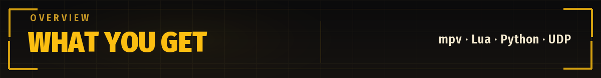
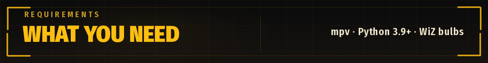
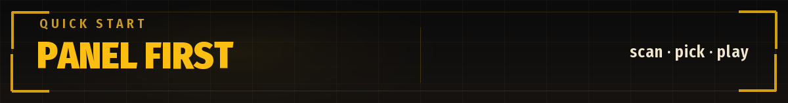
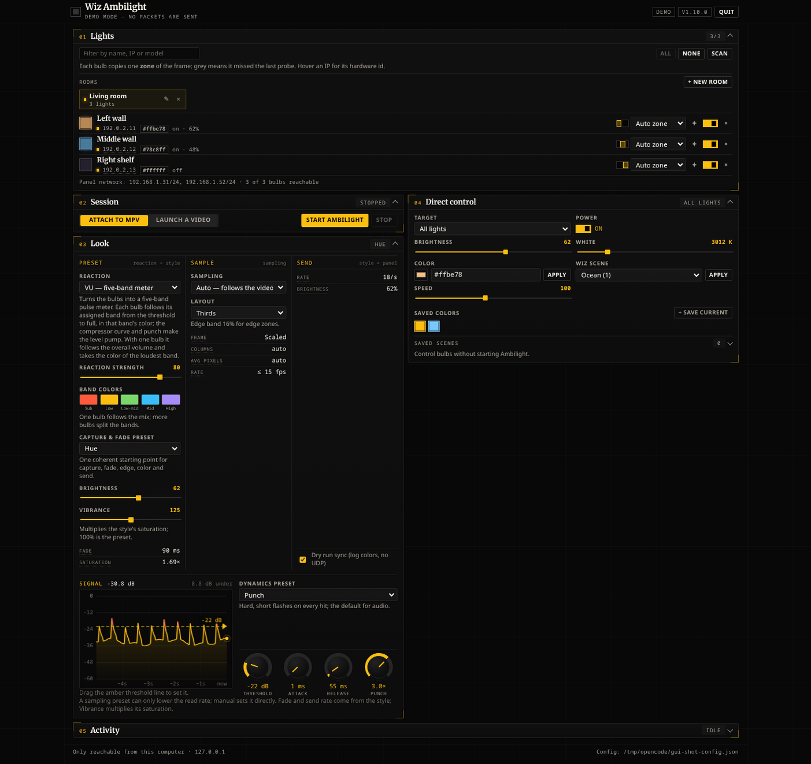
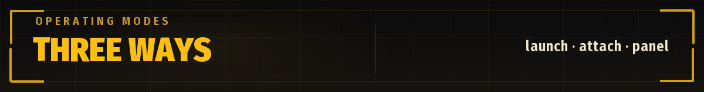
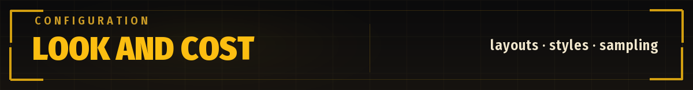
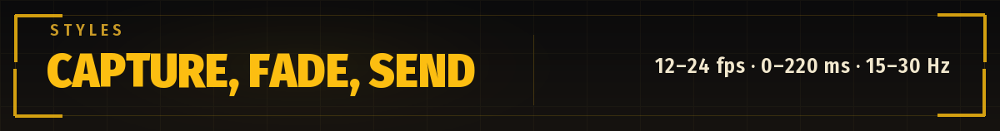
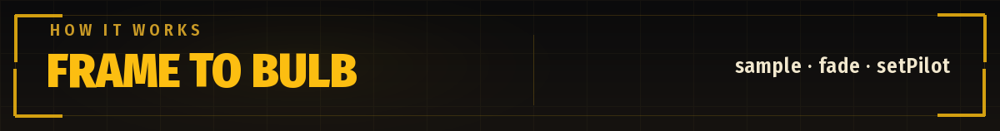
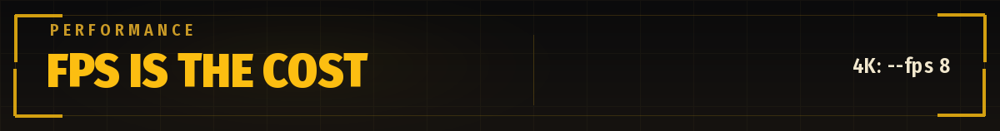

# wiz-ambilight

[](https://github.com/mfascioli/wiz-ambilight/actions/workflows/tests.yml)
[](LICENSE)
[](https://www.python.org/)


`wiz-ambilight` reads the video frame mpv is already decoding and paints the
edges of the picture onto WiZ bulbs over your local network. No capture card,
no re-encoding, no cloud, no extra Python packages.

It is two small pieces: a Lua script inside mpv that samples the frame, and a
Python process that fades the colors and sends `setPilot` datagrams over UDP.
An optional local panel drives the same pipeline by hand.

<p align="center">
  <em>mpv → Lua frame sampler → Python fade loop → WiZ UDP bulbs</em>
</p>

## 🎬 Overview



The video player keeps doing all the heavy work. Hardware decoding, subtitles,
uosc, your own mpv config, 4K, HEVC and network streams keep working because
the picture is never copied out of mpv through a capture device: the Lua script
asks mpv for the frame it has already rendered, averages the edge zones and
writes a few colors to a small JSON file. The Python side reads that file,
interpolates the colors and sends them to the bulbs.

Nothing else is involved. The bulbs are local UDP devices on port `38899`, the
Python side is standard library only, and the web panel is served from your own
machine.

## ✨ Features

- **Uses mpv, not a second player.** The player, its config and its performance
  stay exactly as they are.
- **Hue-style motion at a sane cost.** Capture, fade and send are three
  independent rates; the default samples a window-size frame at 8–15 fps and
  drives the bulbs at 18 Hz with interpolation, so colors glide. See
  [Performance](#-performance).
- **Actually local.** Plain UDP on port `38899`; nothing leaves your LAN.
- **No dependencies.** Standard library Python plus one Lua script.
- **Three ways to run it.** Launch mpv from the tool, attach to an mpv you
  started normally, or use the local panel. See
  [Operating Modes](#-operating-modes).
- **The bulbs are yours.** The panel is also a small WiZ remote: power,
  brightness, white temperature, RGB/hex colors, WiZ scenes, rooms and saved
  colors, without starting Ambilight.
- **Multi-bulb layouts.** Left/right, top/bottom, thirds, whole-frame, or
  explicitly chosen zones per bulb.
- **Reactive modes.** Beyond plain color: equalize room brightness, flash on
  cuts, follow motion, split into a duotone, pulse on the beat or meter the
  five audio bands. Audio analysis is opt-in and runs on mpv's own filters. See
  [Reactions](#-reactions).
- **Panel telemetry.** One chart in **Activity** shows mpv and the panel in
  three unit lanes: CPU %, RAM MB and WiZ UDP KB/s, above the video and
  capture resolution.

## 🧰 Requirements & Compatibility



- [mpv](https://mpv.io/) with a video output that supports `screenshot-raw`
  (the normal GPU outputs do).
- Python **3.9+**. No `pip install` needed.
- One or more WiZ bulbs on the **same LAN/VLAN** as the computer.

| Platform | Status | Notes |
| --- | --- | --- |
| Linux | Supported | All features, including the CPU/RAM lanes of the chart. |
| macOS | Supported | Process checks use `ps`; the CPU/RAM lanes need `/proc`, so the chart shows the UDP lane only. |
| Windows | Not yet | Runtime directory, Lua install path, file picker and a CI runner are missing; process control and PID verification are already platform-safe. See [Roadmap](#-roadmap). |

## 📦 Installation


```bash
git clone https://github.com/mfascioli/wiz-ambilight.git
cd wiz-ambilight
./mpv_ambilight.py --discover
```

`--discover` shows each bulb's IP, model, firmware and state:

```text
192.168.1.5      ESP24_SHRGBC_01    fw=1.38.0   mac=d8a01154f818 state=on  dimming=100 rssi=-54
192.168.1.7      ESP24_SHRGBC_01    fw=1.38.0   mac=d8a01154fba8 state=on  dimming=100 rssi=-58
```

> WiZ does **not** expose the name you assigned in the app over the local UDP
> API, so this tool identifies bulbs by IP and MAC. `--discover --json` gives
> the same data in machine-readable form.

Optional — run it from anywhere:

```bash
mkdir -p ~/.local/bin
ln -s "$PWD/mpv_ambilight.py" ~/.local/bin/mpv-ambilight
```

## ⚡ Quick Start



```bash
# auto-discover the bulbs, bulb 1 = left edge, bulb 2 = right edge
./mpv_ambilight.py movie.mkv

# choose the bulbs yourself
./mpv_ambilight.py --lights 192.168.1.5,192.168.1.7 movie.mkv

# both bulbs follow the whole picture (great when they sit above the TV)
./mpv_ambilight.py --layout all movie.mkv

# pass normal mpv options after a bare "--"
./mpv_ambilight.py movie.mkv -- --fullscreen --sub-file=es.srt
```

When mpv exits, the bulbs keep their last color. Use `--on-exit off` if you
want them to turn off instead.

## 🖥️ Web Panel


If you would rather click than type:

```bash
./mpv_ambilight.py --gui
```

It opens `http://127.0.0.1:8765/` in your browser. The panel scans the LAN,
lists every bulb it finds, and lets you:

- choose and name bulbs (`Sofa`, `TV wall`, …), see their IP and online state,
  and assign a zone per bulb or pick a layout, style, reaction and brightness;
- forget a stale or duplicate row with the two-step **Forget** action; this
  edits `lights.json` and leaves the bulb itself alone. **Scan network** can
  add a reachable bulb back, and the inclusion switch keeps it out of the sync;
- pick a **sampling profile** — auto adapts the grid and capture rate to the
  resolution; lean, balanced and quality trade CPU for detail; manual exposes
  every knob. See [Sampling](#-sampling);
- group bulbs into **rooms**, click a room to target it in **Direct control**,
  and reapply a **saved color** with its brightness instead of opening the
  picker;
- watch **CPU, RAM and WiZ UDP** in **Activity** — one chart with a line each
  for mpv and for the panel, plus the video and capture resolution, read fps
  and process count;
- see the **zone preview** on each bulb row, so “left edge” or “thirds” is not
  just a name;
- use **Direct control** on all bulbs, a room or a single one: a power switch,
  brightness, white temperature, a color picker/**hex** field, WiZ scenes and
  scene speed. It starts collapsed; it is a remote, not the normal path;
- start and stop the sync in **attach** mode or launch a **video file**, save
  or reapply a **scene** from the small menu inside Direct control, follow the
  log, and install the Lua script;
- collapse any section: **Direct control** and **Activity** start closed, so
  the first screen is just lights, session and look.


<sub>Demo mode with three bulbs on thirds: Session and Look share the left stack, the VU reaction shows its signal timeline and Dynamics controls, Direct control sits on the right with rooms and saved colors, and Activity waits below.</sub>

The visual language and the layout rules are documented in
[`docs/design.md`](docs/design.md).

Useful flags:

| flag | meaning |
|---|---|
| `--gui-port 9000` | listen somewhere else (default `8765`) |
| `--no-browser` | do not open a browser automatically |
| `--demo` | fake lights, never send UDP — the three named demo fixtures replace the saved bulbs, good for trying the UI |

The panel is a standard-library `ThreadingHTTPServer` bound to `127.0.0.1`, and
the sync runs as its child, so closing the tab leaves no daemon behind. PID
adoption is checked against the process command line; the platform fallbacks
are in [`SECURITY.md`](SECURITY.md).

Settings and names live in `~/.config/wiz-ambilight/lights.json` (override with
`WIZ_AMBILIGHT_GUI_CONFIG`); saved looks live in `scenes.json`
(`WIZ_AMBILIGHT_SCENES_CONFIG`). WiZ does not expose app-assigned names over
UDP, so names are stored locally and a bulb that moves is matched by MAC. Both
files are plain JSON and validated on load; the schemas are in
[`docs/development.md`](docs/development.md).

## 🔀 Operating Modes



| Mode | Command | What runs |
| --- | --- | --- |
| **Launch** | `./mpv_ambilight.py movie.mkv` | The sync starts mpv with the file and stops when mpv exits. |
| **Attach** | `./mpv_ambilight.py --attach` | The sync waits for an mpv you start yourself and follows it. |
| **Panel** | `./mpv_ambilight.py --gui` | The browser starts, stops or inspects either mode. |

Direct control (`--set`) is separate: it sends one command and exits without
starting a sync. See [Direct WiZ Control](#-direct-wiz-control).

### 🔗 Attach to a running mpv


Install the Lua script once:

```bash
./mpv_ambilight.py --install-script
```

Start mpv the way you normally do — desktop launcher, file manager, shell —
then run:

```bash
./mpv_ambilight.py --attach
```

The Lua script idles unless a live control file exists in
`$XDG_RUNTIME_DIR/wiz-ambilight/`, so installing it globally is safe. `Ctrl+C`
stops the daemon and the script goes back to sleep. If you are already running
a daemon, updating the checkout requires
`./mpv_ambilight.py --install-script --force` and an mpv restart.

### 🔌 Run it as a user service (optional)

This needs the `~/.local/bin/mpv-ambilight` symlink from the installation
section. The service starts with your session and waits for mpv on its own —
no window or terminal is needed.

```bash
mkdir -p ~/.config/wiz-ambilight
cp contrib/wiz-ambilight.env.example ~/.config/wiz-ambilight/env
$EDITOR ~/.config/wiz-ambilight/env

mkdir -p ~/.config/systemd/user
cp contrib/wiz-ambilight.service ~/.config/systemd/user/
systemctl --user daemon-reload
systemctl --user enable --now wiz-ambilight.service
```

## ⚙️ Configuration



A **style** is a coherent starting point, a **layout** assigns zones, a
**sampling profile** decides how much of each frame is copied, and a
**reaction** decides what the bulbs do with it. Individual flags override the
style, and the panel stores your choice in `lights.json` so it applies on the
next start.

### 🎚️ Capture, fade and send

These are three different rates, and mixing them up is the usual source of
surprises:

| Stage | Knob | Unit | What it controls |
| --- | --- | --- | --- |
| **Capture** | `--fps`, or the style / sampling profile | frames per second | How often mpv hands a frame to Lua. Sets CPU cost and how fresh the targets are. |
| **Fade** | `--smooth` | milliseconds | The time constant used to interpolate between targets. `0` disables interpolation. |
| **Send** | `--send-hz` | hertz | How often the fade loop pushes `setPilot` to the bulbs. Sets packet rate, not picture latency. |

Raising capture does not raise the send rate; lowering send does not soften a
cut. The fade loop runs between them, so a target captured at 12 fps still
reaches the bulb smoothly at 18 Hz. Large color jumps (≥128 per channel) snap
on the next frame, so scene cuts land immediately while camera moves fade.

### 🎨 Styles



| style    | capture | fade   | send   | edge band | saturation | dimming | feel                          |
|----------|---------|--------|--------|-----------|------------|---------|-------------------------------|
| `hue`    | 15 fps  | 90 ms  | 18 Hz  | 16%       | 1.35×      | 100     | balanced, Hue-like (default)  |
| `cinema` | 12 fps  | 220 ms | 15 Hz  | 20%       | 1.15×      | 80      | slower, calmer, dimmer        |
| `fast`   | 20 fps  | 45 ms  | 24 Hz  | 12%       | 1.45×      | 100     | snappy, action-friendly       |
| `reactive` | 20 fps | 55 ms | 26 Hz  | 13%       | 1.40×      | 100     | fastest feel; hard cuts snap  |
| `raw`    | 24 fps  | 0 ms   | 30 Hz  | 12%       | 1.30×      | 100     | no interpolation, twitchy     |
| `custom` | —       | —      | —      | —         | —          | —       | start from the built-in values |

```bash
./mpv_ambilight.py --style cinema movie.mkv
./mpv_ambilight.py --style fast --brightness 70 movie.mkv
./mpv_ambilight.py --smooth 150 --saturation 1.5 --send-hz 15 movie.mkv
```

**Vibrance.** The **Vibrance** slider in **Look → Preset** (or
`--vibrance 1.4`) multiplies the style's saturation: `100 %` is the preset,
`200 %` is deliberately loud, and `50 %` mutes the room. It leaves fade, edge
and send rate alone, so it composes with any style and any reaction.
`--saturation` still sets the base value directly.

Use `--style reactive` when you want the snappiest response, or lower
`--smooth` manually. Styles are independent of sampling: changing the profile
never changes fade, edge, saturation or send rate.

### 🎛️ Reactions

A **reaction** is what the bulbs do with the colors: plain color, or one layer
that reacts to the picture or to the audio. The default is still `color`, so
nothing changes unless you ask. The panel shows one **Reaction** dropdown
inside **Look → Preset**, split into **Video** and **Audio** groups, so the
same control says how the lights react and what they react to.

| reaction   | source | what it does |
|------------|--------|--------------|
| `color`    | video  | Classic Ambilight: each bulb copies its own zone. Nothing reacts; this is the baseline look. |
| `equalize` | video  | Measures the average brightness of the frame and slowly raises or lowers every bulb to hold the room near a target. Bright scenes dim, dark scenes lift; the correction is capped and never goes black. |
| `cut`      | video  | A cut is one hard edit, not camera motion. When the whole frame jumps to a new scene, the bulbs flash at full brightness for a moment; between cuts they sit slightly dimmer so the flash reads as a pulse. Rate-limited. |
| `motion`   | video  | Compares each zone with the previous frame. Still shots stay calm and slightly dim; movement adds brightness and saturation to the bulbs watching the action. |
| `duotone`  | video  | Even bulbs keep the sampled color, odd bulbs get the opposite hue. Two bulbs become a complementary pair; more bulbs become a striped duotone. |
| `beat`     | audio  | Listens to five frequency bands. Each bulb owns one band and slams to full brightness when that band jumps above its recent average. A threshold gates quiet ticks, and the 75 % flash span keeps the bulbs low between hits so every one reads as a flash. With one bulb it pulses on the overall beat. |
| `vu`       | audio  | A five-band pulse meter: each bulb follows its band from the gate to full, in that band's color. A compressor-style curve lifts the middle of the range, so the bulbs pump with the music instead of drifting gently. With one bulb it meters the overall volume and takes the color of the loudest band. |

**Strength.** Every reaction scales with `--react-amount` (0–1, default `0.8`);
`0` keeps the source color and disables the reaction. The panel's **Reaction
strength** slider writes the same value.

**Profiles.** `equalize`, `cut` and `motion` have a `soft` / `balanced` /
`strong` profile (`--react-profile`), which moves span, speed, threshold and
rate limit together. `balanced` is the default and matches the numbers below;
`soft` is subtler and slower, `strong` is wider and faster. The profile and the
strength slider compose.

**Dynamics.** Audio modes replace the profile with four compressor-style
controls, in the spirit of an SSL bus compressor. **Threshold** is the dBFS gate
where the bulbs start to open, **Attack** and **Release** are the envelope in
milliseconds, and **Punch** is how hard levels above the gate drive the
brightness. The panel adds **Dynamics preset** with four starting points, four
round knobs, and a live **Signal** timeline: a five-second dBFS trace whose
amber threshold line can be dragged directly. Peaks above the line turn red, so
the relation between the song and the gate is visible before the bulbs move.
The same values are `lights.json` keys and CLI flags.

| preset   | threshold | attack | release | punch | feel |
|----------|-----------|--------|---------|-------|------|
| `Mellow` | −30 dB | 12 ms | 200 ms | 1.4× | slow, rounded fades; the meter breathes with the track |
| `Glue`   | −26 dB | 6 ms | 120 ms | 2.0× | the SSL-style middle: firm, musical pulses without strobing |
| `Punch`  | −22 dB | 1 ms | 55 ms | 3.0× | hard, short flashes on every hit; the default |
| `Strobe` | −18 dB | 0 ms | 30 ms | 4.0× | instant full-scale hits and a fast drop; the most extreme |

**Audio profiles.** `--react-profile` still works for audio modes and selects
the gate, ceiling, envelope and punch as one bundle; choosing a Dynamics preset
in the panel is equivalent to writing the four knobs. The numbers below are
per profile and use the same window: gate…ceiling for the level, attack /
release, punch and the share of the brightness range covered by the flash
(`beat`) or swing (`vu`).

| reaction   | soft | balanced | strong |
|------------|------|----------|--------|
| `equalize` | ±20 %, 6 s average, 55 % floor | ±35 %, 4 s average, 35 % floor | ±55 %, 2 s average, 20 % floor |
| `cut`      | 30 % jump, 3/min, 15 % headroom | 22 % jump, 6/min, 22 % headroom | 14 % jump, 12/min, 35 % headroom |
| `motion`   | 0.18 span, 0.55 s release | 0.28 span, 0.35 s release | 0.40 span, 0.20 s release |
| `beat`     | 4.5 dB jump, −30…−12 dBFS, 12 / 200 ms, punch 1.4, 55 % flash | 3 dB jump, −22…−10 dBFS, 1 / 55 ms, punch 3.0, 75 % flash | 1.5 dB jump, −18…−8 dBFS, 0 / 30 ms, punch 4.0, 95 % flash |
| `vu`       | −30…−12 dBFS, 12 / 200 ms, punch 1.4, 70 % swing | −22…−10 dBFS, 1 / 55 ms, punch 3.0, full swing | −18…−8 dBFS, 0 / 30 ms, punch 4.0, full swing |

**Band colors.** Audio modes split the mix into five bands:
`sub` (<60 Hz), `low` (60–250 Hz), `low-mid` (250–800 Hz), `mid` (800–2500 Hz)
and `high` (>2500 Hz). Each band has its own color picker in **Look → Preset**;
from the CLI the five colors are
`--react-bands '#rrggbb,#rrggbb,#rrggbb,#rrggbb,#rrggbb'`, in that order.
With one bulb the meter follows the overall volume (0–100 %) and takes the
loudest band's color. With 2–5 bulbs the bands are spread from sub to high:
two bulbs get sub/high, three get sub/low-mid/high, four get sub/low/mid/high
and five get one each; more than five repeat the cycle.

Audio modes keep a 30 Hz state heartbeat even when the video is sampled at
12–20 fps: the picture still follows the sampling profile, but the meter and
the beat do not wait for the next frame. Both read RMS and sample peak, so the
first hit is not averaged away. Audio modes also send at 30 Hz, so a 55 ms
release is not dropped between datagrams.

Pulse and meter modes reserve headroom so the flash has somewhere to go:
`beat` covers 55–95 % of the range with the flash across its profiles, leaving
the bulbs at roughly 56–24 % when idle at the default strength, and `vu`
swings over 70–100 % of the range, so the level can fall much darker than a
gentle meter. Equalize is deliberately
slow; it averages the scene instead of pumping with every cut. It can only lift
a dark scene when the brightness ceiling leaves room, so set **Brightness**
around 80 if you want both directions; at 100 it mostly dims.

```bash
# keep the room at a constant brightness
./mpv_ambilight.py --react equalize movie.mkv

# flash on cuts, but gently
./mpv_ambilight.py --react cut --react-amount 0.5 movie.mkv

# sharper reactions across the board
./mpv_ambilight.py --react motion --react-profile strong --react-amount 0.7 movie.mkv

# audio modes: music or any file with an audio track
./mpv_ambilight.py --react vu concert.mkv
./mpv_ambilight.py --react beat --react-profile soft song.flac
./mpv_ambilight.py --react vu --react-threshold -24 --react-punch 4 \
  --react-release 30 concert.mkv
./mpv_ambilight.py --react vu \
  --react-bands '#ff3b30,#ff9500,#ffcc00,#34c759,#5ac8fa' concert.mkv
```

Audio modes use mpv's built-in `lavfi`/`astats` bridge. The Lua script adds a
labelled five-band analyser only while `beat` or `vu` is selected, removes it
when you switch back to a video mode, and never opens a microphone or extra
process. The crossover recombines the five slices before the output, so the
mix keeps its magnitude; like any crossover it adds a small all-pass phase
shift. No extra package is installed. An audio-only file has no frame to
sample, so the bulbs hold a warm white base while the beat or the VU meter
drives their brightness.

`--react-target` (default `0.45`) sets the luma Equalize aims for; lower values
keep the room dimmer, higher values brighter. The panel exposes the mode,
strength, dynamics (presets, threshold, attack, release, punch), a draggable
signal timeline, target and band colors; the same values live in `lights.json`
for scripted setups. The four dynamics values also have CLI flags:
`--react-threshold`, `--react-attack`, `--react-release` and `--react-punch`.

### 🧩 Layouts and zones


The order of `--lights` is the order of the zones.

| layout       | what each bulb shows                              |
|--------------|---------------------------------------------------|
| `auto`       | 1 bulb → `all`; 2 → `left-right`; 3 → `thirds`; 4+ → `cycle` |
| `left-right` | left edge / right edge                            |
| `top-bottom` | top edge / bottom edge                            |
| `thirds`     | left third / middle third / right third           |
| `all`        | average of the whole frame                        |
| `cycle`      | left, right, top, bottom, then repeat             |

> Auto-discovery sorts bulbs by IP. If the sides come out swapped, list the
> IPs in the order you want (`--lights right-ip,left-ip`) or use `--zones`.

### 🔬 Sampling

Samples are a resolution-aware grid: the Lua script crops letterbox and
pillarbox bars, averages vertical slices and block averages them. The profile
decides how much work that is.

`scaled` capture asks mpv for the frame as it appears in the window instead of
the decoded source. A 4K movie in a 1280×720 window copies one ninth of the
pixels, and the bulbs cannot resolve the difference. mpv 0.42 returns the
window size (1280×721 in testing); if a video output refuses, the script falls
back to the source frame once and keeps going.

| profile | capture | columns | block | fps cap | feel |
|---|---|---|---|---|---|
| `auto` (default) | `scaled` | 80 / 96 / 112 | 1×1 / 2×2 | style / 12 / 8 | picks the row from the captured height (≤1200 / ≤1600 / above) |
| `lean` | `scaled` | 48 | 1×1 | 10 | slow laptops and big 4K windows |
| `balanced` | `scaled` | 80 | 2×2 | 15 | slightly softer, less sensor noise |
| `quality` | `source` | 120 | 3×3 | 30 | big TV and a strong GPU; copies the full frame |
| `manual` | any | 24–240 | 1–4 | 1–30 | your call |

`auto` reads the size of the frame it actually got and picks the row above. On
a 1080p window it keeps the original 80-column, 1×1 sampling and the style's
own rate, so nothing gets softer on a normal desktop and `--style raw` still
runs at 24 fps. A 4K capture drops to 8 fps instead of melting the CPU.

```bash
# the default: adapt to the captured resolution
./mpv_ambilight.py movie.mkv

# explicit presets
./mpv_ambilight.py --sampling lean movie.mkv
./mpv_ambilight.py --sampling quality --style cinema movie.mkv

# every knob by hand
./mpv_ambilight.py --sampling manual --fps 12 --sample-grid 96 \
  --sample-block 2 --capture source movie.mkv
```

An explicit `--fps` or `--capture` wins over the profile, so
`--sampling lean --fps 15` keeps lean's 48 columns and raises its cap. In the
panel, **Sampling** sits in the Sample column while **Capture & fade preset**
opens the Preset column under Reaction; both are saved in `lights.json` and
apply on the next start.

### 🌱 Environment

| Variable | Effect |
| --- | --- |
| `WIZ_LIGHTS` / `WIZ_LIGHT_IPS` | Default bulb list when `--lights` is absent. |
| `XDG_RUNTIME_DIR` | Where `state-*.json`, `stats-*.json` and `control.json` live (default `/tmp/wiz-ambilight`). |
| `WIZ_AMBILIGHT_GUI_CONFIG` | Path to `lights.json`. |
| `WIZ_AMBILIGHT_SCENES_CONFIG` | Path to `scenes.json`. |

## 🔆 Direct WiZ Control


The same controls are available without the browser, which makes them easy to
use from shell scripts, cron jobs or desktop shortcuts:

```bash
# turn everything on/off (or one bulb with --lights)
./mpv_ambilight.py --set --power on
./mpv_ambilight.py --set --lights 192.168.1.5 --power off

# RGB as hex (3- or 6-digit), with optional brightness
./mpv_ambilight.py --set --lights 192.168.1.5,192.168.1.7 --hex '#ff8800' --brightness 60

# white temperature instead of color
./mpv_ambilight.py --set --temp 3000

# a WiZ scene, with optional speed
./mpv_ambilight.py --set --scene 4 --speed 120

# preview the UDP payloads without sending anything
./mpv_ambilight.py --set --hex '#00ff7f' --dry-run
```

`--set` uses `--lights`, then `WIZ_LIGHTS` / `WIZ_LIGHT_IPS`, then discovery.
`--hex` and `--temp` are mutually exclusive, `--speed` requires `--scene`, and
`--power off` cannot be combined with a color or brightness. Invalid input
exits with status `2`; a network/discovery failure exits with `1`.

The panel lists every scene it knows about. Common ids are `1` Ocean, `3`
Sunset, `4` Party, `5` Fireplace, `10` Bedtime, `12` Daylight, `16` Relax and
`18` TV time; firmware may expose more.

Because each command exits, `--set` composes with cron, systemd timers and
media-server hooks without a daemon. Recipes for sequencing several looks are
in [`docs/development.md`](docs/development.md#scripted-control-recipes).

## 🔍 Architecture & How It Works




<sub>Everything inside the dashed computer boundary runs as your user. The bulbs are the only untrusted peer; no component talks to the internet.</sub>

**Components and data.** mpv decodes the video and a Lua script samples it,
writing zone colors to `state-<pid>.json` at the capture rate. The sync process
reads that file, fades the colors and sends `setPilot` datagrams to the bulbs.
It also rewrites `stats-<pid>.json` once a second with the capture rate and the
UDP throughput. The optional panel serves its own HTML/CSS/JS from
`127.0.0.1:8765`, writes `lights.json` and `scenes.json`, and starts or stops
the sync with an argument list. The [Mermaid source](docs/architecture.mmd) is
next to the SVG.

```text
              screenshot-raw (video only, no OSD)
 mpv ──────────────────────────────────────────────┐
                                                    ▼
                                   lua/wiz_ambilight.lua
                                   • samples a resolution-aware grid
                                     (48-120 columns)
                                   • crops letterbox/pillarbox bars
                                   • averages edge / third zones
                                                    │
                                                    │ tiny JSON state file
                                                    │ (8-15 writes/s)
                                                    ▼
                            $XDG_RUNTIME_DIR/wiz-ambilight/state*.json
                                                    │
                                                    │ polled every few ms
                                                    ▼
                                   mpv_ambilight.py
                                   • saturation + gamma
                                   • continuous fade toward target
                                   • setPilot UDP @ 18 Hz
                                                    │
                                                    ▼
                                          WiZ bulbs (:38899)
```

The bulbs are fire-and-forget UDP devices. The sender de-duplicates unchanged
colors and refreshes them every 2 seconds, so a single lost packet cannot
leave a bulb stuck on an old frame.

**Exposure.** The panel is the only listening socket, and only while `--gui`
runs; the sync only sends UDP. There is no HTTP client, DNS lookup, account,
telemetry or update check. [`SECURITY.md`](SECURITY.md) lists every file,
process and network surface.

## 📈 Performance



The cost is `screenshot-raw`: mpv copies a frame into Lua on every capture,
then Lua averages a fixed grid. Capture rate is the knob; `--send-hz` only
changes the packet rate. See [Sampling](#-sampling) for the profile table.

`scaled` copies the window; `source` and the `quality` profile copy the decoded
frame, roughly nine times the pixels for 4K in a 1280×720 window. Everything
after the copy — grid sampling, colour math and UDP — is cheap.

Measured on a Ryzen 5 3600X (6C/12T), GTX 1660 Ti with NVDEC, 16 GB and
Wayland: a looping H.264 4K60 clip in a 1280×720 window, three bulbs on
loopback, median of three 15 s runs after a 6 s warm-up. CPU is a share of the
whole machine, as in Activity.

| case | capture | mpv | sync | sync RAM | WiZ UDP |
| --- | --- | --- | --- | --- | --- |
| mpv alone | — | 0.3 % | — | — | — |
| `hue` + `auto` (default) | 1280×720, 15 fps | 1.5 % (0.2 cores) | 0.07 % | 23 MB | 2 KB/s |
| `reactive` + `quality` | 3840×2160, 15 fps | 13 % (1.6 cores) | 0.1 % | 23 MB | 2 KB/s |
| `reactive` + manual max¹ | 3840×2160, 20 fps | 15 % (1.8 cores) | 0.1 % | 23 MB | 1.4 KB/s |

¹ `--sampling manual --fps 30 --sample-grid 240 --sample-block 4 --capture source`.

The sync is never the cost: 0.1 % of the machine and 23 MB in the worst case.
The copy in mpv is, and it self-limits — the manual case asked for 30 fps and
delivered about 20. On a 4K screen the default automatic sampling caps the
source copy at 8 fps and widens the grid. If mpv drops frames, lower `--fps`
or pick `lean`. A hard cut still snaps because large colour jumps bypass the
fade. UDP stays at a few KB/s: an unchanged colour is not re-sent for 2 s.

**Activity** plots the same numbers live — CPU %, RAM MB and UDP KB/s, one line
each for mpv and the panel. CPU is a share of the whole processor; CPU and RSS
read `/proc`, so the chart is Linux-only for those lanes. The UDP rate comes
from `stats-<pid>.json`, so demo and dry-run stay at zero. mpv is attributed
by the pid the Lua script writes into its state file, which is how attach mode
works without a parent link.

## 🔒 Privacy & Security


- **Local only.** The bulbs are reached with UDP on port `38899`; discovery
  broadcasts on the LAN and **Scan network** also probes every address on the
  local `/24`. Nothing is sent to the internet, and the Python side never
  makes an HTTP request.
- **No account, no telemetry, no cloud.** No sign-in, no analytics, no update
  check. The panel is served from `127.0.0.1` and the page loads only its own
  files.
- **One exposed interface, justified.** The panel is the only listener:
  `127.0.0.1:8765`, only while `--gui`. The sync opens no inbound socket; it
  sends UDP from an ephemeral port to `38899`. The
  [architecture diagram](docs/architecture.svg) draws both the data flow and
  the trust boundaries.
- **Panel hardened.** Loopback bind, `Host`/`Origin` checks, a per-run
  `X-Wiz-Token` on every POST and a strict CSP; argument lists instead of a
  shell; paths starting with `-` rejected; only known bulbs; every value
  range-checked; config `0600` inside `0700`. The full list is in
  [`SECURITY.md`](SECURITY.md).
- **PID adoption checks the process.** A stale PID file alone can never make
  the panel adopt, and later stop, a foreign process: it verifies the command
  line through `/proc` or `ps` and refuses when neither exists. Stopping a sync
  uses `killpg` when available and the portable `terminate`/`kill` path
  otherwise.
- **What the bulbs see.** Plain UDP `setPilot` datagrams from your machine,
  unauthenticated by design of the WiZ local API. Anyone on the same LAN can
  do the same — treat the bulbs as LAN devices, not as trusted ones. See
  [`SECURITY.md`](SECURITY.md) for the full model.
- **How it was written.** The code was generated with **DeepSeek V4.1 Flash
  Free** in OpenCode. No other model or tool is claimed for this repository.
  There is no independent audit or published release scan yet; the roadmap
  tracks that gap, and [`SECURITY.md`](SECURITY.md) states what was reviewed
  and what was not.

## 🩺 Troubleshooting


| symptom | fix |
|---|---|
| **No lights found** | `./mpv_ambilight.py --discover`; check that the bulbs and computer are on the same VLAN and that client isolation / guest Wi-Fi is off. Pin them with `--lights ip1,ip2` or `WIZ_LIGHTS`. |
| **Only some bulbs are found** | Press **Scan network** again: a manual scan probes every address on the local `/24` and the broadcast three times, which finds bulbs that ignore broadcast. If one is still missing, it is probably on another VLAN/guest network or outside that subnet; pin it with `--lights ip1,ip2`. |
| **Buttons do nothing / “No reply from …”** | The panel names the bulbs that did not answer. Compare **Panel network** in the panel with the bulb IPs: if it says `192.168.1.5 outside this subnet`, the computer is on a different network (hotspot, VPN, Ethernet bridge down). Join the bulbs' Wi-Fi, or check `ip -brief addr` and the router's client list. |
| **`mpv could not grab frames`** | Your VO does not support raw screenshots. Try `-- --vo=gpu` or `-- --screenshot-sw=yes`. Do not use `--vo=null` or `--no-video`. |
| **Colors look wrong / sides swapped** | Reinstall the Lua script (`./mpv_ambilight.py --install-script --force`), restart mpv, and check the order of `--lights` / `--zones`. |
| **Stutter on 4K** | Use `--sampling lean`, or lower `--fps` (e.g. `--fps 6`). |
| **Bulbs lag behind the picture** | Use `--style reactive` (or `--style fast`) and `--smooth 40 --send-hz 24`. If your bulbs still lag, try `--send-hz 15`; some firmware coalesces very fast updates. |
| **Cuts feel soft** | Use `--style reactive`; large jumps snap automatically, but a lower `--smooth` makes small transitions faster too. |
| **Bulbs keep the last color after quitting** | Expected. Use `--on-exit off` if you want them off. |
| **`--attach` does nothing** | Run `--install-script`, restart mpv, then `--attach`. Check that only one mpv instance is playing (the control file is global). |
| **Panel says “already running”** | A sync child is still alive. Press **Stop**, or use the PID from `sessionPill` / `$XDG_RUNTIME_DIR/wiz-ambilight/gui-daemon.json`. |
| **Port 8765 is taken** | `./mpv_ambilight.py --gui --gui-port 9000`. |
| **Bulb names** | Not available over UDP. Use `--discover` to map IP ↔ model ↔ MAC, or name them in the panel (stored locally). |

## 🧪 Development


```bash
python -m unittest discover -s tests -v
python -m py_compile mpv_ambilight.py webui.py
lua5.4 -e 'assert(loadfile("lua/wiz_ambilight.lua"))'
```

The CI workflow runs the unit tests on Python 3.9, 3.11 and 3.13 and checks
that the Lua script compiles. Tests never touch a real bulb: the panel, the
fade loop and discovery are exercised in-process, and `--demo` keeps the sender
off the network.

Repository layout, the runtime files and config schemas, the scripted control
recipes and the banner generator are documented in
[`docs/development.md`](docs/development.md). The panel design contract is in
[`docs/design.md`](docs/design.md).

## 🗺️ Roadmap


Five pieces are known to be missing, in the order they matter:

1. **Windows.** One resolver for the runtime directory (Python and Lua must
   agree, or attach mode fails silently), `%APPDATA%\mpv\scripts` for
   `--install-script`, a cmdline source for PID adoption, a file picker that
   exists there, and a `windows-latest` job in CI.
2. **Measured transport.** A diagnostic run that records packets sent,
   replies, latency and drops per bulb. "Fire and forget" is fine until a
   datagram is lost; the numbers decide whether re-sending with backoff and
   reconciling with `getPilot` are worth their complexity.
3. **Release hygiene.** A `SECURITY.md` refresh and an antivirus scan of each
   release archive, recorded with its date.
4. **A real light sensor.** Equalize estimates room brightness from the video
   today. A BH1750 or similar writing `lux.json` in the runtime directory
   would let it target a measured lux instead; the hook is designed but not
   implemented. See
   [`docs/development.md`](docs/development.md#light-sensor-design).
5. **UI/UX redesign.** The panel has grown control by control and now asks the
   reader to hold too much in their head. Rework it around Apple's design
   principles — hierarchy, clarity, deference and depth — instead of adding
   another row: one obvious primary action per card, progressive disclosure for
   the tuning knobs, plain-language labels before technical detail, and the
   live meter treated as feedback rather than another control. This is a
   redesign, not a new feature; the Reaction and Dynamics model stays as it is.

## 🙏 Credits & License


- **[wiz-hack](https://github.com/myselfshravan/wiz-hack)** by
  [@myselfshravan](https://github.com/myselfshravan) reverse-engineered the WiZ
  local UDP protocol and built the API server, the music visualizers and the
  first video/Ambilight experiments. This is a focused fork of it: the mpv
  Ambilight path — frame sampling in Lua, a fade loop in Python, layouts,
  styles, attach mode, the web panel and the tests — is what the fork adds,
  and the original toolkit stays in [`upstream/`](upstream/) with its own
  README.
- **[mpv](https://mpv.io/)** decodes and shows the video; this project only
  reads frames from it and never patches or bundles it.
- **[mpv-config](https://github.com/mfascioli/mpv-config)** lent the design
  language: amber `#FCBE11`, charcoal HUD grid and bracket corners.
- **[Merriweather](https://github.com/EbenSorkin/Merriweather)** by Eben
  Sorkin, bundled in `web/fonts/` under the
  [SIL Open Font License](web/fonts/Merriweather-OFL.txt).

Both the original work and these changes are released under the
[MIT license](LICENSE).

## 💡 Related Projects


[**mpv-config**](https://github.com/mfascioli/mpv-config) — the mpv setup this
panel takes its look from, and the other half of the picture: EWA Lanczos
scaling, amber subtitles that reach into the letterbox bars, four audio
profiles and a full keybinding map.
