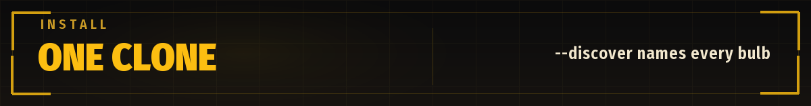
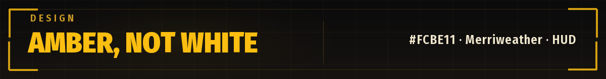
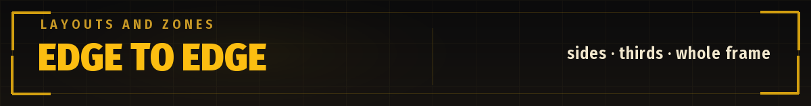
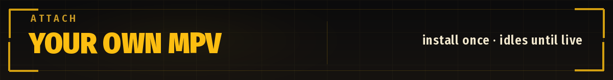
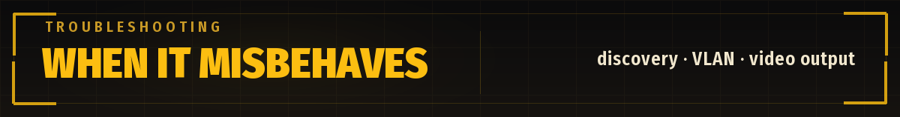
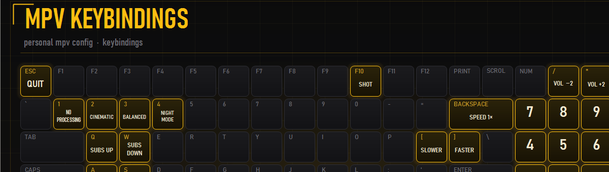

# wiz-ambilight

[](https://github.com/mfascioli/wiz-ambilight/actions/workflows/tests.yml)
[](LICENSE)
[](https://www.python.org/)


`wiz-ambilight` reads the video frame mpv is already decoding and paints the
edges of the picture onto WiZ bulbs over your local network. No capture card,
no re-encoding, no cloud, no extra Python packages.

<p align="center">
  <em>mpv → Lua frame sampler → Python fade loop → WiZ UDP bulbs</em>
</p>

## 🎬 What you get


- **Uses mpv, not a second player.** Hardware decoding, subtitles, uosc, your
  config, 4K, HEVC, network streams — all of it keeps working.
- **Hue-style motion.** The capture side runs at 15 fps by default, but the
  bulbs are driven at 18 Hz with continuous interpolation, so colors glide
  instead of stepping.
- **Actually local.** Plain UDP on port `38899`; nothing leaves your LAN.
- **No dependencies.** The Python side is standard library only. The other
  half is one small mpv Lua script.
- **Three ways to run it.** Let it launch mpv, attach to an mpv you started
  normally (desktop launcher, file manager, whatever), or use the local web
  panel to choose lights and tune the look.
- **The bulbs are yours.** The panel also works as a small local WiZ remote:
  power, brightness, white temperature, RGB/hex colors, WiZ scenes and saved
  looks, without starting Ambilight.
- **Multi-bulb layouts.** Left/right, top/bottom, thirds, whole-frame, or
  explicitly chosen zones per bulb.

## 🧰 Requirements


- [mpv](https://mpv.io/) with a video output that supports `screenshot-raw`
  (the normal GPU outputs do).
- Python **3.9+**. No `pip install` needed.
- One or more WiZ bulbs on the **same LAN/VLAN** as the computer.
- Linux or macOS today. Windows still needs a handful of changes — the
  runtime directory, the Lua install path, process control and a CI runner —
  listed in [Roadmap](#roadmap).

## 📦 Install



```bash
git clone https://github.com/mfascioli/wiz-ambilight.git
cd wiz-ambilight
./mpv_ambilight.py --discover
```

`--discover` shows each bulb's IP, model, firmware and state:

```text
192.168.1.5      ESP24_SHRGBC_01    fw=1.38.0   mac=d8a01154f818 state=on  dimming=100 rssi=-54
192.168.1.7      ESP24_SHRGBC_01    fw=1.38.0   mac=d8a01154fba8 state=on  dimming=100 rssi=-58
```

> WiZ does **not** expose the name you assigned in the app over the local UDP
> API, so this tool identifies bulbs by IP and MAC. `--discover --json` gives
> the same data in machine-readable form.

Optional — run it from anywhere:

```bash
mkdir -p ~/.local/bin
ln -s "$PWD/mpv_ambilight.py" ~/.local/bin/mpv-ambilight
```

## ⚡ Quick start


```bash
# auto-discover the bulbs, bulb 1 = left edge, bulb 2 = right edge
./mpv_ambilight.py movie.mkv

# choose the bulbs yourself
./mpv_ambilight.py --lights 192.168.1.5,192.168.1.7 movie.mkv

# both bulbs follow the whole picture (great when they sit above the TV)
./mpv_ambilight.py --layout all movie.mkv

# pass normal mpv options after a bare "--"
./mpv_ambilight.py movie.mkv -- --fullscreen --sub-file=es.srt
```

When mpv exits, the bulbs keep their last color. Use `--on-exit off` if you
want them to turn off instead.

## 🖥️ Web panel


If you would rather click than type:

```bash
./mpv_ambilight.py --gui
```

It opens `http://127.0.0.1:8765/` in your browser. The panel scans the LAN,
lists every bulb it finds, and lets you:

- choose which bulbs take part and name them (`Sofa`, `TV wall`, …);
- see each bulb's model, firmware, IP, online state and **effective zone**;
- assign a zone per bulb or pick a layout, style and brightness;
- preview the **zone map** (`Sofa glow → top-left`) before starting;
- include or exclude every light at once, with one **All / None** click;
- use **Direct control** on all bulbs or a single one: power, brightness,
  white temperature, a color picker/**hex** field, WiZ scenes and scene speed;
- press **Crazy 20 s** for a rainbow at 15 updates/s that stops by itself
  (capped at 20/s, and it will not start while the sync owns the bulbs);
- see **which bulbs answer**: every manual command waits for a reply, and a
  silent bulb is greyed out with a warning instead of failing quietly;
- click the **hex chip** under a bulb to send that exact color to the target;
- save the current look as a **scene** and apply or delete it later;
- flash a bulb to identify it, or toggle its power;
- start/stop the sync in **attach** mode or launch a **video file**;
- follow the sync log, with connection-loss recovery and a confirm-to-quit step;
- install the mpv Lua script with one click.


<sub>Attach mode while syncing: names, live state, zone map and activity log.</sub>

Useful flags:

| flag | meaning |
|---|---|
| `--gui-port 9000` | listen somewhere else (default `8765`) |
| `--no-browser` | do not open a browser automatically |
| `--demo` | fake lights, never send UDP — good for trying the UI |

The panel is a standard-library `ThreadingHTTPServer` bound to `127.0.0.1`. The
sync runs as a child process, so closing the tab or the panel does not leave a
stray daemon behind; the panel also adopts a sync it started before a restart
(PID file in `$XDG_RUNTIME_DIR/wiz-ambilight/gui-daemon.json`).

Settings and names live in
`~/.config/wiz-ambilight/lights.json` (override with
`WIZ_AMBILIGHT_GUI_CONFIG`). WiZ does not expose app-assigned names over UDP,
so names are stored locally. If DHCP moves a bulb, the panel matches it by MAC
and keeps its name and zone.

Saved looks live in `~/.config/wiz-ambilight/scenes.json` (override with
`WIZ_AMBILIGHT_SCENES_CONFIG`). It is plain JSON, so a script can generate or
edit scenes without going through the panel:

```json
{
  "Movie night": {
    "192.168.1.5": {"state": true, "r": 255, "g": 80, "b": 20, "dimming": 40},
    "192.168.1.7": {"state": true, "sceneId": 4, "speed": 80}
  }
}
```

Only bulbs the panel already knows about are applied, and every value is
range-checked.

### 🎛️ Direct control from the CLI

The same controls are available without the browser, which makes them easy to
use from shell scripts, cron jobs or desktop shortcuts:

```bash
# turn everything on/off (or one bulb with --lights)
./mpv_ambilight.py --set --power on
./mpv_ambilight.py --set --lights 192.168.1.5 --power off

# RGB as hex (3- or 6-digit), with optional brightness
./mpv_ambilight.py --set --lights 192.168.1.5,192.168.1.7 --hex '#ff8800' --brightness 60

# white temperature instead of color
./mpv_ambilight.py --set --temp 3000

# a WiZ scene, with optional speed
./mpv_ambilight.py --set --scene 4 --speed 120

# preview the UDP payloads without sending anything
./mpv_ambilight.py --set --hex '#00ff7f' --dry-run
```

`--set` uses `--lights`, then `WIZ_LIGHTS` / `WIZ_LIGHT_IPS`, then discovery.
`--hex` and `--temp` are mutually exclusive, `--speed` requires `--scene`, and
`--power off` cannot be combined with a color or brightness. Invalid input
exits with status `2`; a network/discovery failure exits with `1`.

The panel lists every scene it knows about. Common ids are `1` Ocean, `3`
Sunset, `4` Party, `5` Fireplace, `10` Bedtime, `12` Daylight, `16` Relax and
`18` TV time; firmware may expose more.

Because this is just a normal command, a script can sequence several looks:

```bash
#!/bin/sh
# sunset.sh — warm the room, then settle into a scene
LIGHTS=192.168.1.5,192.168.1.7
cd /path/to/wiz-ambilight
./mpv_ambilight.py --set --lights "$LIGHTS" --hex '#ff8a3d' --brightness 70
sleep 3
./mpv_ambilight.py --set --lights "$LIGHTS" --scene 3 --speed 60
```

Schedule it with cron or a systemd timer exactly like any other command. The
same primitive (and the JSON scenes file) is enough to wire the bulbs into
desktop shortcuts, media servers or home-automation scripts without adding a
dependency or a cloud account.

## 🎨 Design



The panel borrows its visual language from
[mpv-config](https://github.com/mfascioli/mpv-config): **amber `#FCBE11`**,
`#1F1F1F` hairlines, a charcoal HUD grid, bracket corners and Merriweather
Bold for headings. Merriweather ships in `web/fonts/` under the SIL OFL, so
the panel needs no network and no installed fonts.

The flow is numbered on screen — **01 Lights → 02 Session → 03 Direct
control → 04 Look → 05 Scenes → 06 Activity** — with a three-step quick
start at the top, so the first run does not require reading this README.

[`tests/test_design.py`](tests/test_design.py) pins the design: the exact
amber and outline tokens, square HUD corners, the bundled font and licence,
and the numbered reading order. A restyle that drifts back to a generic
dashboard fails CI.

## 🎚️ Styles


A style is a coherent starting point; any individual flag overrides it.

| style    | capture | fade   | send   | edge band | saturation | dimming | feel                          |
|----------|---------|--------|--------|-----------|------------|---------|-------------------------------|
| `hue`    | 15 fps  | 90 ms  | 18 Hz  | 16%       | 1.35×      | 100     | balanced, Hue-like (default)  |
| `cinema` | 12 fps  | 220 ms | 15 Hz  | 20%       | 1.15×      | 80      | slower, calmer, dimmer        |
| `fast`   | 20 fps  | 45 ms  | 24 Hz  | 12%       | 1.45×      | 100     | snappy, action-friendly       |
| `reactive` | 20 fps | 55 ms | 26 Hz  | 13%       | 1.40×      | 100     | fastest feel; hard cuts snap  |
| `raw`    | 24 fps  | 0 ms   | 30 Hz  | 12%       | 1.30×      | 100     | no interpolation, twitchy     |
| `custom` | —       | —      | —      | —         | —          | —       | start from the built-in values |

Every style also snaps a large color jump (≥128 per channel) on the next frame,
so scene cuts land immediately while gentle camera moves still fade. Use
`--style reactive` when you want the snappiest response, or lower `--smooth`
manually.

```bash
./mpv_ambilight.py --style cinema movie.mkv
./mpv_ambilight.py --style fast --brightness 70 movie.mkv
./mpv_ambilight.py --style reactive movie.mkv
./mpv_ambilight.py --smooth 150 --saturation 1.5 --send-hz 15 movie.mkv
```

## 🧩 Layouts and zones



The order of `--lights` is the order of the zones.

| layout       | what each bulb shows                              |
|--------------|---------------------------------------------------|
| `auto`       | 1 bulb → `all`; 2 → `left-right`; 3 → `thirds`; 4+ → `cycle` |
| `left-right` | left edge / right edge                            |
| `top-bottom` | top edge / bottom edge                            |
| `thirds`     | left third / middle third / right third           |
| `all`        | average of the whole frame                        |
| `cycle`      | left, right, top, bottom, then repeat             |

> Auto-discovery sorts bulbs by IP. If the sides come out swapped, list the
> IPs in the order you want (`--lights right-ip,left-ip`) or use `--zones`.

## 🔗 Attach to a running mpv



Install the Lua script once:

```bash
./mpv_ambilight.py --install-script
```

Start mpv the way you normally do — desktop launcher, file manager, shell —
then run:

```bash
./mpv_ambilight.py --attach
```

The Lua script idles unless a live control file exists in
`$XDG_RUNTIME_DIR/wiz-ambilight/`, so installing it globally is safe. `Ctrl+C`
stops the daemon and the script goes back to sleep. If you are already running
a daemon, updating the checkout requires
`./mpv_ambilight.py --install-script --force` and an mpv restart.

### 🔌 Run it as a user service (optional)

This needs the `~/.local/bin/mpv-ambilight` symlink from the install section.
The service starts with your session and waits for mpv on its own — no window
or terminal is needed.

```bash
mkdir -p ~/.config/wiz-ambilight
cp contrib/wiz-ambilight.env.example ~/.config/wiz-ambilight/env
$EDITOR ~/.config/wiz-ambilight/env

mkdir -p ~/.config/systemd/user
cp contrib/wiz-ambilight.service ~/.config/systemd/user/
systemctl --user daemon-reload
systemctl --user enable --now wiz-ambilight.service
```

## 🔍 How it works


```text
              screenshot-raw (video only, no OSD)
 mpv ──────────────────────────────────────────────┐
                                                    ▼
                                   lua/wiz_ambilight.lua
                                   • samples an 80-column grid
                                   • crops letterbox/pillarbox bars
                                   • averages edge / third zones
                                                    │
                                                    │ tiny JSON state file
                                                    │ (~15 writes/s)
                                                    ▼
                            $XDG_RUNTIME_DIR/wiz-ambilight/state*.json
                                                    │
                                                    │ polled every few ms
                                                    ▼
                                   mpv_ambilight.py
                                   • saturation + gamma
                                   • continuous fade toward target
                                   • setPilot UDP @ 18 Hz
                                                    │
                                                    ▼
                                          WiZ bulbs (:38899)
```

Two details make it feel like Ambilight instead of a color slideshow:

1. **Capture and output run at different rates.** New targets arrive at
   `--fps`; the fade loop interpolates them every few milliseconds and sends
   at `--send-hz`.
2. **Colors settle, they do not jump.** Exponential smoothing with a
   wall-clock time constant means a seek or a cut fades over ~90 ms instead of
   flashing.

The bulbs are fire-and-forget UDP devices. The sender de-duplicates unchanged
colors and refreshes them every 2 seconds, so a single lost packet cannot
leave a bulb stuck on an old frame.

## 📈 Performance


The expensive part is `screenshot-raw`, which copies a full video frame into
Lua. At 1080p and 15 fps that is fine on a normal desktop. For 4K, try:

```bash
./mpv_ambilight.py --fps 8 movie.mkv
```

Everything else — the grid sampling, color math and UDP sends — is cheap. If
mpv stutters, lower `--fps` first; `--send-hz` only affects network traffic,
not decode.

## 🩺 Troubleshooting



| symptom | fix |
|---|---|
| **No lights found** | `./mpv_ambilight.py --discover`; check that the bulbs and computer are on the same VLAN and that client isolation / guest Wi-Fi is off. Pin them with `--lights ip1,ip2` or `WIZ_LIGHTS`. |
| **Only some bulbs are found** | Press **Scan network** again: a manual scan probes the broadcast three times and then every address on the local `/24`, which finds bulbs that ignore broadcast. If one is still missing, it is probably on another VLAN/guest network or outside that subnet; pin it with `--lights ip1,ip2`. |
| **Buttons do nothing / “No reply from …”** | The panel names the bulbs that did not answer. Compare **Panel network** in the panel with the bulb IPs: if it says `192.168.1.5 outside this subnet`, the computer is on a different network (hotspot, VPN, Ethernet bridge down). Join the bulbs' Wi-Fi, or check `ip -brief addr` and the router's client list. |
| **Crazy mode stops early** | It is capped at 20 updates/s and 20 s on purpose; faster streams make cheap Wi-Fi radios drop packets and look slower. It also refuses to start while the sync is running, because both would fight over the bulbs. |
| **`mpv could not grab frames`** | Your VO does not support raw screenshots. Try `-- --vo=gpu` or `-- --screenshot-sw=yes`. Do not use `--vo=null` or `--no-video`. |
| **Colors look wrong / sides swapped** | Reinstall the Lua script (`./mpv_ambilight.py --install-script --force`), restart mpv, and check the order of `--lights` / `--zones`. |
| **Stutter on 4K** | Lower `--fps` (e.g. `--fps 6`) or use `--style cinema`. |
| **Bulbs lag behind the picture** | Use `--style reactive` (or `--style fast`) and `--smooth 40 --send-hz 24`. If your bulbs still lag, try `--send-hz 15`; some firmware coalesces very fast updates. |
| **Cuts feel soft** | Use `--style reactive`; large jumps snap automatically, but a lower `--smooth` makes small transitions faster too. |
| **Bulbs keep the last color after quitting** | Expected. Use `--on-exit off` if you want them off. |
| **`--attach` does nothing** | Run `--install-script`, restart mpv, then `--attach`. Check that only one mpv instance is playing (the control file is global). |
| **Panel says “already running”** | A sync child is still alive. Press **Stop**, or use the PID from `sessionPill` / `$XDG_RUNTIME_DIR/wiz-ambilight/gui-daemon.json`. |
| **Port 8765 is taken** | `./mpv_ambilight.py --gui --gui-port 9000`. |
| **Bulb names** | Not available over UDP. Use `--discover` to map IP ↔ model ↔ MAC, or name them in the panel (stored locally). |

## 🧪 Development


```bash
python -m unittest discover -s tests -v
python -m py_compile mpv_ambilight.py webui.py
lua5.4 -e 'assert(loadfile("lua/wiz_ambilight.lua"))'
```

The CI workflow runs the unit tests on Python 3.9, 3.11 and 3.13 and checks
that the Lua script compiles.

Repository layout:

```text
.
├── mpv_ambilight.py        # CLI, discovery, fade loop, UDP sender
├── webui.py                # local web panel server and config
├── web/                    # panel HTML/CSS/JS (no build step)
│   └── fonts/              # bundled Merriweather Bold + SIL OFL licence
├── lua/wiz_ambilight.lua   # runs inside mpv, writes zone colors as JSON
├── tests/                  # dependency-free unit tests
├── assets/                 # README banners + their generator
│   └── banner-fonts/       # Fira Sans Condensed for banner.py only
├── docs/gui.png            # the one panel screenshot in this README
├── contrib/                # optional systemd user service
└── upstream/               # original wiz-hack toolkit, kept for reference
```

### Roadmap

Three pieces are known to be missing, in the order they matter:

1. **Windows.** One resolver for the runtime directory (Python and Lua must
   agree, or attach mode fails silently), `%APPDATA%\mpv\scripts` for
   `--install-script`, a stop path that does not call `os.killpg` and a PID
   check that does not depend on `/proc`, a file picker that exists there, and
   a `windows-latest` job in CI.
2. **Measured transport.** A diagnostic run that records packets sent,
   replies, latency and drops per bulb. "Fire and forget" is fine until a
   datagram is lost; the numbers decide whether re-sending with backoff and
   reconciling with `getPilot` are worth their complexity.
3. **Release hygiene.** A `SECURITY.md` refresh and an antivirus scan of each
   release archive, recorded with its date.

## 🔒 Privacy and security


- **Local only.** The bulbs are reached with UDP on port `38899`; discovery
  broadcasts on the LAN and **Scan network** also probes every address on the
  local `/24`. Nothing is sent to the internet, and the Python side never
  makes an HTTP request.
- **No account, no telemetry, no cloud.** No sign-in, no analytics, no update
  check. The panel is served from `127.0.0.1` and the page loads only its own
  files.
- **Panel hardened.** It binds to `127.0.0.1` and rejects requests whose `Host`
  or `Origin` is not the panel itself, which also blocks DNS-rebinding tricks;
  every POST needs a random per-run `X-Wiz-Token`; the CSP is
  `default-src 'none'` with only its own JS/CSS/fonts; child processes and the
  file picker use argument lists, never a shell; a video path starting with
  `-` is rejected so it cannot become an mpv option; identify, power and direct
  control only accept bulbs the panel already knows; colors, temperatures,
  scene ids and speeds are range-checked; `lights.json` and `scenes.json` are
  written `0600` inside a `0700` directory.
- **What the bulbs see.** Plain UDP `setPilot` datagrams from your machine,
  unauthenticated by design of the WiZ local API. Anyone on the same LAN can
  do the same — treat the bulbs as LAN devices, not as trusted ones. See
  [`SECURITY.md`](SECURITY.md) for the full model.
- **How it was written.** Most of the code was generated with **DeepSeek V4.1
  Flash Free** in OpenCode and reviewed with **Claude Sonnet 5.5** and
  **GPT-6 Luna**, the same workflow as
  [`mpv-config`](https://github.com/mfascioli/mpv-config). No independent audit
  or release scan has been published yet; the roadmap tracks that gap, and
  [`SECURITY.md`](SECURITY.md) states what was reviewed and what was not.

## 🙏 Credits and license


- **[wiz-hack](https://github.com/myselfshravan/wiz-hack)** by
  [@myselfshravan](https://github.com/myselfshravan) reverse-engineered the WiZ
  local UDP protocol and built the API server, the music visualizers and the
  first video/Ambilight experiments. This is a focused fork of it: the mpv
  Ambilight path — frame sampling in Lua, a fade loop in Python, layouts,
  styles, attach mode, the web panel and the tests — is what the fork adds,
  and the original toolkit stays in [`upstream/`](upstream/) with its own
  README.
- **[mpv](https://mpv.io/)** decodes and shows the video; this project only
  reads frames from it and never patches or bundles it.
- **[mpv-config](https://github.com/mfascioli/mpv-config)** lent the design
  language: amber `#FCBE11`, charcoal HUD grid and bracket corners.
- **[Merriweather](https://github.com/EbenSorkin/Merriweather)** by Eben
  Sorkin, bundled in `web/fonts/` under the
  [SIL Open Font License](web/fonts/Merriweather-OFL.txt).

Both the original work and these changes are released under the
[MIT license](LICENSE).

## 💡 Also check out



[**mpv-config**](https://github.com/mfascioli/mpv-config) — the mpv setup this
panel takes its look from, and the other half of the picture: EWA Lanczos
scaling, amber subtitles that reach into the letterbox bars, four audio
profiles and a full keybinding map.
