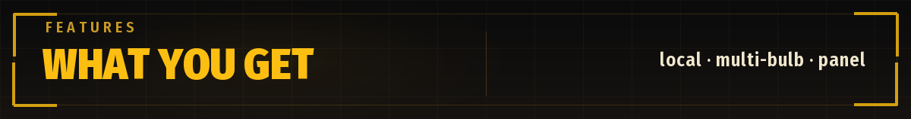
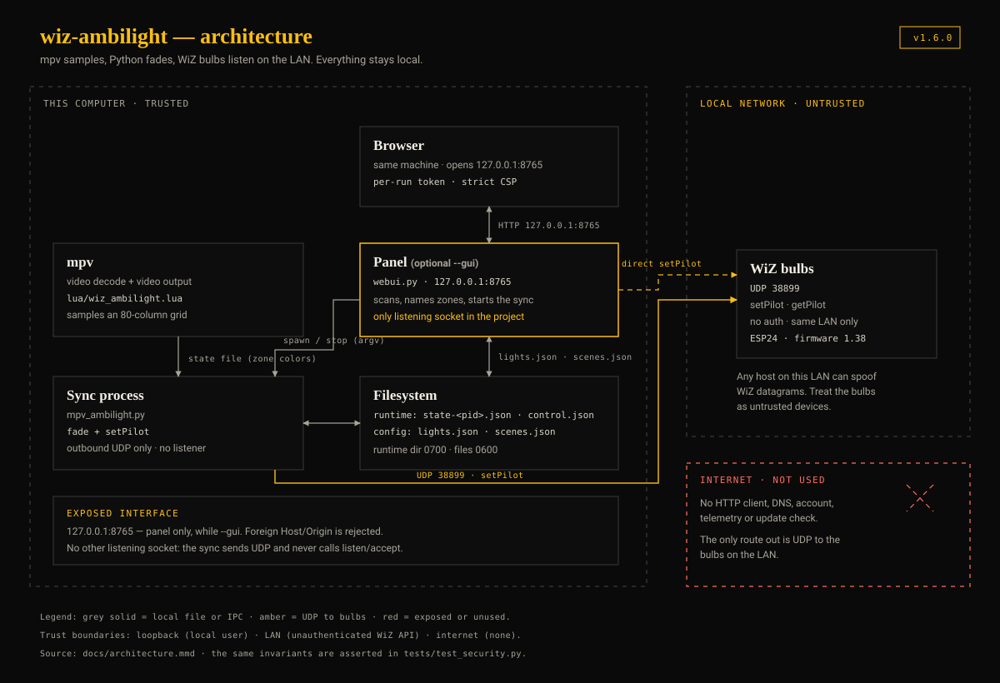
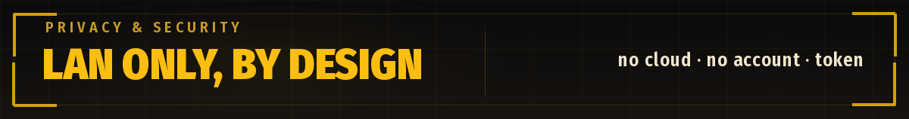
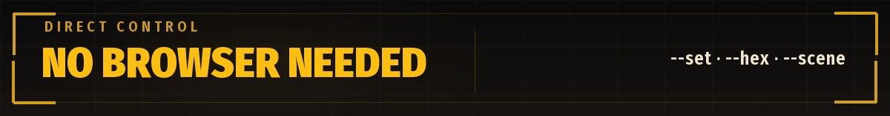
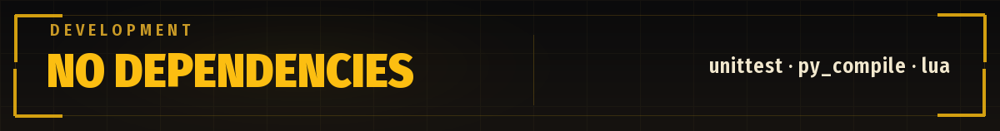
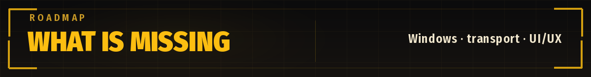
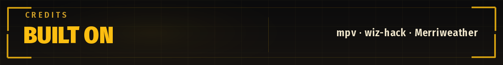
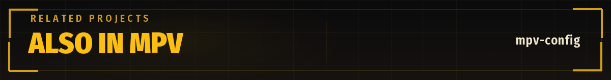

# wiz-ambilight

[](https://github.com/mfascioli/wiz-ambilight/actions/workflows/tests.yml)
[](LICENSE)
[](https://www.python.org/)


`wiz-ambilight` reads the video frame mpv is already decoding and paints the
edges of the picture onto WiZ bulbs over your local network. No capture card,
no re-encoding, no cloud, no extra Python packages.

It is two small pieces: a Lua script inside mpv that samples the frame, and a
Python process that fades the colors and sends `setPilot` datagrams over UDP. A
local web panel is the main interface; the same program also runs from the
terminal.

<p align="center">
  <em>mpv → Lua frame sampler → Python fade loop → WiZ UDP bulbs</em>
</p>

## 🎬 Overview


The video player keeps doing all the heavy work. Hardware decoding, subtitles,
uosc, your own mpv config, 4K, HEVC and network streams keep working because
the picture is never copied out of mpv through a capture device: the Lua script
asks mpv for the frame it has already rendered, averages the edge zones and
writes a few colors to a small JSON file. The Python side reads that file,
interpolates the colors and sends them to the bulbs.

The bulbs are local UDP devices on port `38899`, the Python side is standard
library only, and the panel is served from your own machine. Nothing else is
involved.

## ✨ Features



- **Uses mpv, not a second player.** The player, its config and its performance
  stay exactly as they are.
- **Hue-style motion at a sane cost.** Colors glide between samples instead of
  stepping, and the cost is low enough to leave mpv alone. See
  [Performance](#-performance).
- **No dependencies.** Standard-library Python plus one Lua script.
- **Two sources, one panel.** Launch a video from the panel, or attach it to an
  mpv you started normally.
- **The bulbs are yours.** The panel is also a small WiZ remote: power,
  brightness, white temperature, RGB/hex colors, WiZ scenes, rooms and saved
  colors, without starting Ambilight. **Direct control** shows the target's
  metered draw when the firmware reports it, and an opt-in **White LEDs**
  switch sends the grey part of each color on the dedicated white LEDs.
- **Multi-bulb layouts.** Left/right, top/bottom, thirds, whole-frame, or
  explicitly chosen zones per bulb.
- **Reactive modes.** Beyond plain color: equalize room brightness, flash on
  cuts, follow motion, split into a duotone, pulse on the beat or meter the
  audio bands. See [Reactions](#-reactions).
- **Optional light sensor.** A BH1750, VEML7700, MAX44009, OPT3001 or TSL2591
  on an ESP32 adds measured lux as **Auto Lux**, a brightness layer over any
  reaction. See [Reactions](#-reactions).
- **Audio without a microphone.** Beat and VU read mpv's own audio analyser.
  See [Audio Processing](#-audio-processing).
- **Graphic EQ with shapes.** 2–16 bands, each a bell, band pass, low/high
  pass, notch or flat pass, with slope, solo and a lamp per band. See
  [Graphic EQ](#-graphic-eq).
- **Panel telemetry.** **Activity** charts CPU, RAM and WiZ UDP traffic for mpv
  and the panel while a session runs. See [Performance](#-performance).

## 📋 Requirements & Compatibility


- [mpv](https://mpv.io/) with a video output that supports `screenshot-raw`
  (the normal GPU outputs do).
- Python **3.9+**. No `pip install` needed.
- One or more WiZ bulbs on the **same LAN/VLAN** as the computer.

| Platform | Status | Notes |
| --- | --- | --- |
| Linux | Supported | All features, including the CPU/RAM lanes of the chart. |
| macOS | Supported | Process checks use `ps`; the CPU/RAM lanes need `/proc`, so the chart shows the UDP lane only. |
| Windows | Not yet | Runtime directory, Lua install path, file picker and a CI runner are missing; process control and PID verification are already platform-safe. See [Roadmap](#-roadmap). |

## 🚀 Getting Started


```bash
git clone https://github.com/mfascioli/wiz-ambilight.git
cd wiz-ambilight
./mpv_ambilight.py --gui
```

The panel opens at `http://127.0.0.1:8765/`. There is nothing else to install:
Python needs no packages, and the panel loads the Lua script from the checkout
when it launches mpv.

Attach mode is the only exception: it needs a one-time Lua copy, explained in
[Attach to your own mpv](#-attach-to-your-own-mpv).

> WiZ does not expose app-assigned names over UDP, so the panel identifies
> bulbs by IP and MAC and stores your names locally.

### First run

1. With the panel open, press **Scan network**, tick the bulbs you want, and
   name them.
2. In **Look**, pick a layout, a style (the default `hue` is a good start) and a
   reaction (the default `color` is classic Ambilight). Leave **Sampling** on
   `auto`.
3. In **Session**, choose **Launch a video** and pick a file — or **Attach to
   mpv** after the one-time script install — then press **Start Ambilight**.
4. Collapse **Direct control** and **Activity**; they start closed and are not
   needed for normal playback.

The bulbs keep the last color when playback ends. To switch them off instead,
use `--on-exit off` from the [command line reference](docs/cli.md).

The terminal equivalents — discovery, launch and attach commands, direct
control and scripting — are in [`docs/cli.md`](docs/cli.md).

## 🖥️ Web Panel & Operating Modes


The panel is the normal interface. It scans the LAN, lists every bulb it finds,
and keeps the first screen focused on the three things a session needs:

| Section | What it does |
| --- | --- |
| **Lights** | Filter by name, IP or model; **All** / **None**; **Scan network**; name bulbs and see IP, online state, model and MAC; assign a zone per bulb or pick a layout; preview the zone on each row; include or exclude a bulb from the sync; **Identify** to flash a bulb; two-step **Forget** to remove a stale row from `lights.json` without touching the bulb; create **rooms** and pick their members. The **Install script** banner appears when attach mode needs the Lua copy. |
| **Session** | Choose **Attach to mpv** or **Launch a video**; start, restart or stop the sync; choose a file with **Browse**; follow the session state. |
| **Look** | **Reaction** (Video / Audio groups), reaction strength, profile or dynamics, target luma, audio color mode and its swatches or two-color row, **Capture & fade preset**, **Brightness**, **Vibrance**, **Sampling**, **Layout**, manual read fps / sample columns / block average / frame source, a **White LEDs** switch and a dry-run switch that apply to the sync. Audio modes add the dynamics and graphic-EQ strips. |
| **Direct control** | Target all bulbs, a room or one bulb; power with the target's metered draw when the firmware reports it, brightness, white temperature, color picker / **hex**, WiZ scenes and scene speed; save a color, reapply a saved color, and save or reapply a **scene** (a saved look). It starts collapsed and is a remote, not the normal path. |
| **Activity** | Live CPU, RAM and WiZ UDP chart for mpv and the panel, plus the video and capture resolution, read fps, process count and a clearable log. It starts collapsed. |

The header shows the status dot, the demo and version badges, and **Quit**,
which stops the sync and closes the panel.


<sub>Demo mode with three bulbs on thirds: Session and Look share the left stack, the VU reaction shows its signal timeline, Dynamics controls and 8-band EQ, Direct control sits on the right, and Activity waits below.</sub>

The visual language and the layout rules are documented in
[`docs/design.md`](docs/design.md).

Useful flags:

| flag | meaning |
|---|---|
| `--gui-port 9000` | listen somewhere else (default `8765`) |
| `--no-browser` | do not open a browser automatically |
| `--demo` | fake lights, never send UDP — three named fixtures stand in for the saved bulbs in the panel, good for trying the UI |

The panel is a standard-library `ThreadingHTTPServer` bound to `127.0.0.1`, and
the sync runs as its child, so **Quit** (or `Ctrl+C`) stops both and leaves no
daemon behind. PID adoption is checked against the process command line; the
platform fallbacks are in [`SECURITY.md`](SECURITY.md).

The panel writes its settings to `lights.json` and its saved looks to
`scenes.json`. Defaults, overrides and the environment variables that move them
are in [Environment](#-environment); the schemas are in
[`docs/development.md`](docs/development.md#config-format).

### 🔀 Operating Modes


**Launch a video** starts mpv from the panel and stops when mpv exits;
**Attach to mpv** follows an mpv you started yourself. Direct control is
separate: it sends a command to the selected bulb, room or all bulbs without
starting a sync. When the firmware meters its own draw, Direct control adds it
to the power state (`On · 4.2 W`); newer firmware reports it in `getPilot`,
older metering models answer `getPower`, and bulbs that do neither simply show
`On`. The total covers the selected target and notes how many bulbs answered
when only some of them meter.

#### 🔗 Attach to your own mpv


Attach is the only mode that needs the Lua script copied into mpv, because mpv
is already running when the panel appears. Launch mode passes the script to the
mpv it starts, so it needs nothing.

1. Start the panel. If the banner says the script is missing or outdated, press
   **Install script**. It is a local copy, never a download.
2. Start mpv the way you normally do — desktop launcher, file manager, shell.
3. In **Session**, choose **Attach to mpv** and press **Start Ambilight**.

The installed script idles unless a live control file exists in the runtime
directory, so installing it once is safe. After updating the checkout, reinstall
it and restart mpv; the panel shows the same banner when the copy is stale. Only
one mpv instance can be followed, because the control file is global. The
command-line equivalents and the optional systemd user service are in
[`docs/cli.md`](docs/cli.md).

## ⚙️ Configuration


A **style** is a coherent starting point, a **layout** assigns zones, a
**sampling profile** decides how much of each frame is copied, and a
**reaction** decides what the bulbs do with it. The panel saves your choice in
`lights.json`; a running sync restarts so the change applies. The same values
are command-line flags, listed in the
[command line reference](docs/cli.md).

### 🎚️ Capture, Fade & Send

These are three different rates, and mixing them up is the usual source of
surprises:

| Stage | Knob | Unit | What it controls |
| --- | --- | --- | --- |
| **Capture** | `--fps`, or the style / sampling profile | frames per second | How often mpv hands a frame to Lua. Sets CPU cost and how fresh the targets are. |
| **Fade** | `--smooth` | milliseconds | The time constant used to interpolate between targets. `0` disables interpolation. |
| **Send** | `--send-hz` | hertz | How often the fade loop pushes `setPilot` to the bulbs. Sets packet rate, not picture latency. |

Raising capture does not raise the send rate; lowering send does not soften a
cut. The fade loop runs between them, so a target captured at 12 fps still
reaches the bulb smoothly at 18 Hz. Large color jumps (≥128 per channel) snap
on the next frame, so scene cuts land immediately while camera moves fade.

**White LEDs.** Greys mixed from red, green and blue can look slightly tinted.
The **White LEDs** switch in **Look → Send** (or `--white-leds`) moves the grey
part of each color — the smallest of the three channels — onto the bulb's `c`
and `w` channels and subtracts it from RGB, following
[`cB-Sigma/wiz`](https://github.com/cB-Sigma/wiz). Saturated colors are
unchanged. It is opt-in because not every model exposes usable white channels.

### 🎨 Styles


| style    | capture | fade   | send   | edge band | saturation | dimming | feel                          |
|----------|---------|--------|--------|-----------|------------|---------|-------------------------------|
| `hue`    | 15 fps  | 90 ms  | 18 Hz  | 16%       | 1.35×      | 100     | balanced, Hue-like (default)  |
| `cinema` | 12 fps  | 220 ms | 15 Hz  | 20%       | 1.15×      | 80      | slower, calmer, dimmer        |
| `fast`   | 20 fps  | 45 ms  | 24 Hz  | 12%       | 1.45×      | 100     | snappy, action-friendly       |
| `reactive` | 20 fps | 55 ms | 26 Hz  | 13%       | 1.40×      | 100     | fastest feel; hard cuts snap  |
| `raw`    | 24 fps  | 0 ms   | 30 Hz  | 12%       | 1.30×      | 100     | no interpolation, twitchy     |
| `custom` | —       | —      | —      | —         | —          | —       | start from the built-in values |

**Vibrance.** The **Vibrance** slider in **Look → Preset** multiplies the
style's saturation: `100 %` is the preset, `200 %` is deliberately loud, and
`50 %` mutes the room. It leaves fade, edge and send rate alone, so it composes
with any style and any reaction. `--saturation` still sets the base value
directly.

Pick `reactive` when you want the snappiest response; `custom` starts from the
built-in values. Styles are independent of sampling: changing the profile never
changes fade, edge, saturation or send rate.

### 🔬 Sampling

Samples are a resolution-aware grid: the Lua script crops letterbox and
pillarbox bars, averages vertical slices and block averages them. The profile
decides how much work that is.

`scaled` capture asks mpv for the frame as it appears in the window instead of
the decoded source. A 4K movie in a 1280×720 window copies one ninth of the
pixels, and the bulbs cannot resolve the difference. mpv 0.42 returns the
window size (1280×721 in testing); if a video output refuses, the script falls
back to the source frame once and keeps going.

| profile | capture | columns | block | fps cap | feel |
|---|---|---|---|---|---|
| `auto` (default) | `scaled` | 80 / 96 / 112 | 1×1 / 2×2 | style / 12 / 8 | picks the row from the captured height (≤1200 / ≤1600 / above) |
| `lean` | `scaled` | 48 | 1×1 | 10 | slow laptops and big 4K windows |
| `balanced` | `scaled` | 80 | 2×2 | 15 | slightly softer, less sensor noise |
| `quality` | `source` | 120 | 3×3 | 30 | big TV and a strong GPU; copies the full frame |
| `manual` | any | 24–240 | 1–4 | 1–30 | your call |

`auto` reads the size of the frame it actually got and picks the row above. On
a 1080p window it keeps the original 80-column, 1×1 sampling and the style's
own rate, so nothing gets softer on a normal desktop and `--style raw` still
runs at 24 fps. A 4K capture drops to 8 fps instead of melting the CPU.

An explicit `--fps` or `--capture` wins over the profile; the panel writes the
same values. **Sampling** sits in the Sample column while **Capture & fade
preset** opens the Preset column under Reaction; both are saved in
`lights.json`. Flags and precedence are in the
[command line reference](docs/cli.md#styles-reactions-and-sampling).

### 🧩 Layouts & Zones


The order of the bulbs is the order of the zones. In the panel you assign a
zone per bulb or pick a layout; from the terminal, `--lights` sets the order and
`--zones` overrides it (see the [command line reference](docs/cli.md)).

| layout       | what each bulb shows                              |
|--------------|---------------------------------------------------|
| `auto`       | 1 bulb → `all`; 2 → `left-right`; 3 → `thirds`; 4+ → `cycle` |
| `left-right` | left edge / right edge                            |
| `top-bottom` | top edge / bottom edge                            |
| `thirds`     | left third / middle third / right third           |
| `all`        | average of the whole frame                        |
| `cycle`      | left, right, top, bottom, then repeat             |

A zone chosen on a bulb row wins over the layout; bulbs left on auto follow the
layout. With two bulbs, `thirds` uses the outer thirds (`t1` and `t3`). If
`--zones` lists fewer zones than there are bulbs, the list repeats.

> Auto-discovery sorts bulbs by IP. If the sides come out swapped, reorder the
> bulbs in the panel or list the IPs in the order you want from the terminal.

### 🎛️ Reactions

A **reaction** is what the bulbs do with the colors: plain color, or one layer
that reacts to the picture or to the audio. The default is still `color`, so
nothing changes unless you ask. The panel shows one **Reaction** dropdown
inside **Look → Preset**, split into **Video** and **Audio** groups, so the
same control says how the lights react and what they react to.

| reaction   | source | what it does |
|------------|--------|--------------|
| `color`    | video  | Classic Ambilight: each bulb copies its own zone. Nothing reacts; this is the baseline look. |
| `equalize` | video  | Measures the average brightness of the frame and slowly raises or lowers every bulb to hold the room near a target. Bright scenes dim, dark scenes lift; the correction is capped and never goes black. |
| `cut`      | video  | A cut is one hard edit, not camera motion. When the whole frame jumps to a new scene, the bulbs flash at full brightness for a moment; between cuts they sit slightly dimmer so the flash reads as a pulse. Rate-limited. |
| `motion`   | video  | Compares each zone with the previous frame. Still shots stay calm and slightly dim; movement adds brightness and saturation to the bulbs watching the action. |
| `duotone`  | video  | Even bulbs keep the sampled color, odd bulbs get the opposite hue. Two bulbs become a complementary pair; more bulbs become a striped duotone. |
| `beat`     | audio  | Listens to the graphic EQ bands. Each bulb owns one band (or a group of bands) and slams to full brightness when that band jumps above its recent average. A threshold gates quiet ticks. With one bulb it pulses on the overall beat. |
| `vu`       | audio  | A graphic-EQ pulse meter: each bulb follows its band from the gate to full, in that band's color. With one bulb it meters the overall volume and takes the color of the loudest band. |

**Strength.** Every reaction scales with `--react-amount` (0–1, default `0.8`);
`0` keeps the source color and disables the reaction. The panel's **Reaction
strength** slider writes the same value.

**Profiles.** `equalize`, `cut` and `motion` have a `soft` / `balanced` /
`strong` profile (`--react-profile`), which moves span, speed, threshold and
rate limit together. `balanced` is the default and matches the numbers below;
`soft` is subtler and slower, `strong` is wider and faster. The profile and the
strength slider compose. Audio modes use the same profile as a starting bundle;
their values are in [Audio Dynamics](#-audio-dynamics).

| reaction   | soft | balanced | strong |
|------------|------|----------|--------|
| `equalize` | ±20 %, 6 s average, 55 % floor | ±35 %, 4 s average, 35 % floor | ±55 %, 2 s average, 20 % floor |
| `cut`      | 30 % jump, 3/min, 15 % headroom | 22 % jump, 6/min, 22 % headroom | 14 % jump, 12/min, 35 % headroom |
| `motion`   | 0.18 span, 0.55 s release | 0.28 span, 0.35 s release | 0.40 span, 0.20 s release |

**Target.** `--react-target` (default `0.45`) sets the luma Equalize aims for;
lower values keep the room dimmer, higher values brighter. Equalize is
deliberately slow; it averages the scene instead of pumping with every cut. It
can only lift a dark scene when the brightness ceiling leaves room, so set
**Brightness** around 80 if you want both directions; at 100 it mostly dims.

**Auto Lux.** A checkbox in **Look** turns the optional light sensor into a
brightness layer for **every** reaction: color, equalize, cut, motion, duotone,
beat and vu keep their own colors and pulses, while Auto Lux holds the room at
`--lux-target` (default `50`). `contrib/lux-bridge.py` receives a reading from
an ESP32 over Wi-Fi and writes `lux.json`; the sketch supports a **BH1750**
(default), **VEML7700**, **MAX44009**, **OPT3001** or **TSL2591**. While the
file is fresh (under 5 s) the layer works, and a missing or stale file leaves
the chosen reaction untouched. Equalize keeps `--react-target` as its fallback
when there is no reading. The panel shows the current reading and its age.
Setup, wiring and the limits are in
[`contrib/lux-sensor.md`](contrib/lux-sensor.md).

The panel exposes every reaction in **Look → Preset**, with the strength,
profile or dynamics that apply. The matching flags and command examples are in
the [command line reference](docs/cli.md#styles-reactions-and-sampling).

### 🔊 Audio Dynamics

Audio modes replace the profile with four compressor-style controls, in the
spirit of an SSL bus compressor. **Threshold** is the dBFS gate where the bulbs
start to open, **Attack** and **Release** are the envelope in milliseconds, and
**Punch** is how hard levels above the gate drive the brightness: at 1× the
bulbs rise gently, at 4× a small push above the gate reaches full brightness.
The timeline stops at **−36 dBFS**, like Pro-C 2. The threshold knob carries
the plugin's **−60…0 dB** side-chain ring: a white dot walks toward 0 dB as the
song gets louder, turns red while the input is above the gate, and crosses an
amber tick that marks the threshold. The amber dial inside the ring is the
threshold itself, so the knob and the tick always agree.

The gate keeps at least **12 dB** of range above it, even when the profile
ceiling is closer. Raise the threshold to −14 dB and the bulbs still have
−14…−2 dBFS to work with; without that floor the window would shrink to a
couple of dB and the bulbs would turn into an on/off switch.

**Preset** is simply a starting point for the four knobs; the panel writes all
four values when you pick one, and every knob stays editable afterwards. The
**Signal** timeline is a five-second dBFS trace: the amber line is the input,
the red curtain hangs from the top border and its depth is the light drive
(the brightness the bulbs are being asked for, inverted like a compressor's
gain-reduction meter), and the amber line across the graph is the threshold.
Drag it directly to move the gate. The same values are `lights.json` keys and
CLI flags.

| preset   | threshold | attack | release | punch | feel |
|----------|-----------|--------|---------|-------|------|
| `Smooth` | −28 dB | 12 ms | 200 ms | 1.4× | slow swells; the bulbs breathe with the track, no flashing |
| `Steady` | −24 dB | 6 ms | 120 ms | 2.0× | even pulses that follow the mix without strobing |
| `Punchy` | −18 dB | 1 ms | 55 ms | 3.0× | sharp hits on every beat; the default |
| `Strobe` | −14 dB | 0 ms | 30 ms | 4.0× | only the loudest hits flash; the most extreme |

`--react-profile` still works for audio modes and selects the gate, ceiling,
envelope and punch as one bundle; choosing a preset in the panel is
equivalent to writing the four knobs. The numbers below are per profile and use
the same window: gate…ceiling for the level, attack / release, punch and the
share of the brightness range covered by the flash (`beat`) or swing (`vu`).

| reaction   | soft | balanced | strong |
|------------|------|----------|--------|
| `beat`     | 4.5 dB jump, −30…−12 dBFS, 12 / 200 ms, punch 1.4, 55 % flash | 3 dB jump, −18…−6 dBFS, 1 / 55 ms, punch 3.0, 75 % flash | 1.5 dB jump, −14…−2 dBFS, 0 / 30 ms, punch 4.0, 95 % flash |
| `vu`       | −30…−12 dBFS, 12 / 200 ms, punch 1.4, 70 % swing | −18…−6 dBFS, 1 / 55 ms, punch 3.0, full swing | −14…−2 dBFS, 0 / 30 ms, punch 4.0, full swing |

Pulse and meter modes reserve headroom so the flash has somewhere to go:
`beat` covers 55–95 % of the range with the flash across its profiles, leaving
the bulbs at roughly 56–24 % when idle at the default strength, and `vu`
swings over 70–100 % of the range, so the level can fall much darker than a
gentle meter.

### 🎛 Graphic EQ

Audio modes feed from a graphic EQ with **2 to 16 bands** (default **8**). Each
band carries **frequency**, **shape**, **Q**, **slope**, **gain**, **lamp** and
**solo**. The panel's **EQ** strip under Dynamics draws the curve and one fader
per band; drag a fader or a node on the curve, or use the detail row for the
selected band.

- **Frequency** is the band centre, 20 Hz–20 kHz.
- **Shape** isolates the band in the analyser, Pro-Q style:
  **Bell** is the classic two-pole band, **Band pass** keeps only a slice around
  the centre, **Low pass** and **High pass** keep everything below or above it,
  **Notch** removes the centre, and **Flat** passes the full mix.
- **Q** sets the width of a bell, band pass or notch. A high Q is narrow and
  surgical; a low Q is broad and picks up more of its neighbours, which is useful
  when there are fewer bulbs than bands.
- **Slope** (12, 24 or 48 dB/oct) sets how hard a low pass, high pass or band pass
  falls away outside its edges. Bell and notch ignore it.
- **Gain** moves the band ±18 dB in the detector only. It never changes the
  audio mpv plays; it decides how hard that band drives its lamp.
- **Lamp** assigns the band to one enabled bulb, in the panel's light order.
  **Auto** keeps the even spread.
- **Solo** (the **S** on each fader) makes every bulb follow only the soloed
  bands, ignoring lamp assignments until you switch it off.

Bands are stored low-to-high. Two or more bands can share a bulb: the bulb
averages their active levels and takes the color of the strongest one. A bulb
with no explicit assignment follows the overall mix. With no assignments at
all, the bands are spread evenly across the bulbs and repeat when there are
more bulbs than bands.

`--react-eq-bands N` sets the count,
`--react-eq '[{"freq":80,"type":"lowpass","slope":24,"gain":-6,"q":2,"lamp":0},…]'`
sets the bands, `--react-bands` takes exactly N colors, and `lights.json` uses
`react_eq_bands` and `react_eq`. New EQs start as bells with log-spaced
centres from 32 Hz to 16 kHz; `slope` defaults to 24. A missing `type` or
`slope` falls back to `bell` and `24`.

**Active bands.** **Detect active bands** (default off) compares every band with
its own slow noise floor. A band must rise **4 dB** above that floor and stay
there for **180 ms** before it lights a bulb, so a steady bed under a kick no
longer keeps a bulb lit. With one bulb the overall view becomes the loudest
active band.

**Auto release.** The **Auto release** select shapes the brightness envelope,
inspired by two bus compressors:

| mode | behaviour |
| --- | --- |
| `off` | fixed attack and release from the knobs |
| `ssl` | program-dependent dual release: fast after a hit, slower while the mix stays compressed |
| `api` | soft knee lifts quiet detail, a longer steady release and a gentle low-end thrust |
| `hybrid` | SSL dual release with the API soft knee and low-end thrust |

The auto modes only change the lamp envelope; the audio path stays untouched.
They are `--react-auto off|ssl|api|hybrid`, and active detection is
`--react-active-bands`.

### 🎵 Audio Colors

Audio modes have six color sources, picked in **Look → Audio colors**. The
panel swaps its controls to match the mode, and `lights.json` / the CLI use the
same names.

| mode | color source | controls |
| --- | --- | --- |
| `bands` | one fixed color per EQ band | one swatch per band |
| `spectrum` | fixed spectral spread across the bands | none |
| `rainbow` | hue rotating over ~12 s, offset per bulb | none |
| `range` | blend from the low color to the high color across the bands | two colors |
| `level` | blend from the soft color to the loud color as the level rises | two colors |
| `single` | one fixed color | one color |

`bands` is the default. With the default 8-band EQ the centres and colors are:

| band | centre | default color |
| --- | --- | --- |
| 1 | 32 Hz | `#ff5a3c` |
| 2 | 78 Hz | `#fcbe11` |
| 3 | 189 Hz | `#7ad66b` |
| 4 | 459 Hz | `#38bdf8` |
| 5 | 1.1 kHz | `#a78bfa` |
| 6 | 2.7 kHz | `#f472b6` |
| 7 | 6.6 kHz | `#2dd4bf` |
| 8 | 16 kHz | `#fb923c` |

Change any centre and the label follows; the palette keeps cycling through 16
distinct swatches for larger EQs. Each band has its own color picker in
**Look → Audio colors** when `bands` is selected; from the CLI pass exactly one
`#rrggbb` per band, e.g.
`--react-bands '#rrggbb,#rrggbb,#rrggbb,#rrggbb,#rrggbb,#rrggbb,#rrggbb,#rrggbb'`.
`range` and `level` use two colors, `--react-color-a` and `--react-color-b`
(default `#fcbe11` and `#38bdf8`); `single` uses only color A. The mode itself
is `--react-color-mode bands|spectrum|rainbow|range|level|single`.

The default 8-band crossover splits at roughly 50, 121, 294, 716, 1739, 4224
and 10264 Hz; moving a band's frequency or Q moves its boundaries. With one
bulb the meter follows the overall volume (0–100 %) and takes the loudest
band's color. With fewer bulbs than bands the bands are spread evenly; with
more bulbs than bands the assignment repeats. An explicit **Lamp** on a band
overrides that spread, and several bands may share one bulb.

### 🎧 Audio Processing

Audio modes use mpv's built-in `lavfi`/`astats` bridge. The Lua script builds a
labelled N-band analyser from the EQ's band plan only while `beat` or `vu` is
selected, removes it when you switch back to a video mode, and never opens a
microphone or extra process. Each band runs its own filter — a bell, a band
pass, a low/high pass, a notch or a flat pass — on a copy of the mix. The copy
is split N ways, the filtered bands are merged back, and the untouched mix is
merged beside them as the last two channels; `astats` reads every band and
`pan` selects only the original stereo pair, so the audio mpv plays is
unchanged. The analyser measures only per-band RMS and peak, so even a 16-band
EQ costs a few percent of a core instead of most of one. No extra package is
installed.

Older configs without a band plan still use the `acrossover` fallback: N−1
splits yield N contiguous bands, and `amerge` plus `pan` recombine their 2N
channels before the output. Like any crossover it adds a small all-pass phase
shift, which is why the shaped analyser is the default for new configs.

Audio modes keep a 30 Hz state heartbeat even when the video is sampled at
12–20 fps: the picture still follows the sampling profile, but the meter and
the beat do not wait for the next frame. Both read RMS and sample peak, so the
first hit is not averaged away. Audio modes also send at 30 Hz, so a 55 ms
release is not dropped between datagrams.

An audio-only file has no frame to sample, so the bulbs hold a warm white base
while the beat or the VU meter drives their brightness.

## 📈 Performance


The cost is `screenshot-raw`: mpv copies a frame into Lua on every capture,
then Lua averages a fixed grid. The capture stage is the knob; the three rates
are explained once in [Capture, Fade & Send](#-capture-fade--send). See
[Sampling](#-sampling) for the profile table.

`scaled` copies the window; `source` and the `quality` profile copy the decoded
frame, roughly nine times the pixels for 4K in a 1280×720 window. Everything
after the copy — grid sampling, color math and UDP — is cheap.

Measured on a Ryzen 5 3600X (6C/12T), GTX 1660 Ti with NVDEC, 16 GB and
Wayland: a looping H.264 4K60 clip in a 1280×720 window, three bulbs on
loopback, median of three 15 s runs after a 6 s warm-up. CPU is a share of the
whole machine, as in Activity.

| case | capture | mpv | sync | sync RAM | WiZ UDP |
| --- | --- | --- | --- | --- | --- |
| mpv alone | — | 0.3 % | — | — | — |
| `hue` + `auto` (default) | 1280×720, 15 fps | 1.5 % (0.2 cores) | 0.07 % | 23 MB | 2 KB/s |
| `reactive` + `quality` | 3840×2160, 15 fps | 13 % (1.6 cores) | 0.1 % | 23 MB | 2 KB/s |
| `reactive` + manual max¹ | 3840×2160, 20 fps | 15 % (1.8 cores) | 0.1 % | 23 MB | 1.4 KB/s |

¹ `--sampling manual --fps 30 --sample-grid 240 --sample-block 4 --capture source`.

The sync is never the cost: 0.1 % of the machine and 23 MB in the worst case.
The copy in mpv is, and it self-limits — the manual case asked for 30 fps and
delivered about 20. On a 4K screen the default automatic sampling caps the
source copy at 8 fps and widens the grid. If mpv drops frames, lower `--fps`
or pick `lean`. UDP stays at a few KB/s: an unchanged color is not re-sent
for 2 s.

**Activity** plots the same numbers live — CPU %, RAM MB and UDP KB/s, one line
each for mpv and the panel. CPU is a share of the whole processor; CPU and RSS
read `/proc`, so the chart is Linux-only for those lanes. The UDP rate comes
from `stats-<pid>.json`, so demo and dry-run stay at zero. mpv is attributed
by the pid the Lua script writes into its state file, which is how attach mode
works without a parent link.

## 🔍 Architecture



<sub>Everything inside the dashed computer boundary runs as your user. The bulbs are the only untrusted peer; the internet is never used.</sub>

**Components and data.** mpv decodes the video and a Lua script samples it,
writing zone colors to a small JSON state file at the capture rate. The sync
process reads that file, fades the colors and sends `setPilot` datagrams to the
bulbs.
It also rewrites `stats-<pid>.json` once a second with the capture rate and the
UDP throughput. The optional panel serves its own HTML/CSS/JS from
`127.0.0.1:8765`, writes `lights.json` and `scenes.json`, and starts or stops
the sync with an argument list. The [Mermaid source](docs/architecture.mmd) is
next to the SVG.

```text
              screenshot-raw (video only, no OSD)
 mpv ──────────────────────────────────────────────┐
                                                    ▼
                                   lua/wiz_ambilight.lua
                                   • samples a resolution-aware grid
                                     (48-120 columns)
                                   • crops letterbox/pillarbox bars
                                   • averages edge / third zones
                                                    │
                                                    │ tiny JSON state file
                                                    │ (8-15 writes/s)
                                                    ▼
                            $XDG_RUNTIME_DIR/wiz-ambilight/state*.json
                                                    │
                                                    │ polled every few ms
                                                    ▼
                                   mpv_ambilight.py
                                   • saturation + gamma
                                   • continuous fade toward target
                                   • setPilot UDP @ 18 Hz
                                                    │
                                                    ▼
                                          WiZ bulbs (:38899)
```

The bulbs are fire-and-forget UDP devices. The sender de-duplicates unchanged
colors and refreshes them every 2 seconds, so a single lost packet cannot
leave a bulb stuck on an old frame.

The sync only sends UDP. The exposed surface, its bind address and the file and
process guarantees are in [`SECURITY.md`](SECURITY.md).

## 🔒 Privacy & Security



- **Local only.** The bulbs are reached with UDP on port `38899`; discovery
  broadcasts on the LAN and **Scan network** also probes every address on the
  local `/24`. Nothing is sent to the internet, and the Python side never
  makes an HTTP request.
- **No account, no telemetry, no cloud.** No sign-in, no analytics, no update
  check; the page loads only its own files.
- **One exposed interface, justified.** The panel is the only listener, bound
  to `127.0.0.1:8765` while `--gui` runs; the sync opens no inbound socket.
  The [architecture diagram](docs/architecture.svg) draws both the data flow
  and the trust boundaries.
- **Panel hardened.** Loopback bind, `Host`/`Origin` checks, a per-run
  `X-Wiz-Token` on every POST and a strict CSP; argument lists instead of a
  shell; paths starting with `-` rejected; only known bulbs; every value
  range-checked; config `0600` inside `0700`. The full list is in
  [`SECURITY.md`](SECURITY.md).
- **PID adoption checks the process.** A stale PID file alone can never make
  the panel adopt, and later stop, a foreign process: it verifies the command
  line through `/proc` or `ps` and refuses when neither exists. Stopping a sync
  uses `killpg` when available and the portable `terminate`/`kill` path
  otherwise.
- **What the bulbs see.** Plain UDP `setPilot` datagrams from your machine,
  unauthenticated by design of the WiZ local API. Anyone on the same LAN can
  do the same — treat the bulbs as LAN devices, not as trusted ones. See
  [`SECURITY.md`](SECURITY.md) for the full model.
- **How it was written.** The code was generated with **DeepSeek V4.1 Flash
  Free** in OpenCode. No other model or tool is claimed for this repository.
  There is no independent audit or published release scan yet; the roadmap
  tracks that gap, and [`SECURITY.md`](SECURITY.md) states what was reviewed
  and what was not.

## 🌱 Environment

These are the only project-specific variables the runtime reads. Paths are
created with the permissions described in
[`docs/development.md`](docs/development.md#files-the-runtime-creates).

| Variable | Effect |
| --- | --- |
| `WIZ_LIGHTS` / `WIZ_LIGHT_IPS` | Default bulb list when `--lights` is absent. |
| `XDG_RUNTIME_DIR` | Where `state*.json`, `stats-*.json`, `control.json`, `gui-daemon.json` and the optional `lux.json` live (default `/tmp/wiz-ambilight`). |
| `XDG_CONFIG_HOME` | Base for `wiz-ambilight/lights.json`, `scenes.json` and `mpv/scripts/wiz_ambilight.lua` (default `~/.config`). |
| `WIZ_AMBILIGHT_GUI_CONFIG` | Path to `lights.json`. |
| `WIZ_AMBILIGHT_SCENES_CONFIG` | Path to `scenes.json`. |

The runtime directory is `0700`; the two configuration files are written
`0600`. The JSON schemas are in
[`docs/development.md`](docs/development.md#config-format).

## ⌨️ Command Line



The panel covers daily use. Everything it does is also available from the
terminal: discovery, launch and attach modes, direct WiZ control with `--set`,
styles, reactions, sampling, the optional systemd user service and scripted
looks.

The full reference is in [`docs/cli.md`](docs/cli.md). It lists every flag, its
default and its range, so the README does not repeat the command catalogue.

## 🩺 Troubleshooting


| symptom | fix |
|---|---|
| **No lights found** | Press **Scan network**; check that the bulbs and computer are on the same VLAN and that client isolation / guest Wi-Fi is off. If a bulb is on another subnet, pin it with `--lights` / `WIZ_LIGHTS` from the [command line](docs/cli.md). |
| **Only some bulbs are found** | Press **Scan network** again: a manual scan probes every address on the local `/24` and the broadcast three times, which finds bulbs that ignore broadcast. If one is still missing, it is probably on another VLAN/guest network or outside that subnet; pin it from the [command line](docs/cli.md). |
| **Buttons do nothing / “No reply from …”** | The panel names the bulbs that did not answer. Compare **Panel network** in the panel with the bulb IPs: if it says `192.168.1.5 outside this subnet`, the computer is on a different network (hotspot, VPN, Ethernet bridge down). Join the bulbs' Wi-Fi, or check `ip -brief addr` and the router's client list. |
| **`mpv could not grab frames`** | Your VO does not support raw screenshots. Launch the file with a GPU output (`--vo=gpu`) or software screenshots (`--screenshot-sw=yes`) after `--`; do not use `--vo=null` or `--no-video`. |
| **Colors look wrong / sides swapped** | Press **Install script** in the panel to replace the copy, restart mpv, and check the zone assigned to each bulb in **Lights**. |
| **Stutter on 4K** | Pick `lean` in **Sampling**; lower the capture rate from the [command line](docs/cli.md) if needed. |
| **Bulbs lag behind the picture** | Pick `reactive` in **Capture & fade preset**; the finer fade and send values are in the [command line reference](docs/cli.md). |
| **Cuts feel soft** | Pick `reactive`; lower the fade value from the [command line](docs/cli.md) for smaller transitions too. |
| **Bulbs keep the last color after quitting** | Expected. `--on-exit off` from the [command line](docs/cli.md) turns them off instead. |
| **Attach does nothing** | Press **Install script** in the panel, restart mpv, choose **Attach to mpv** and press **Start Ambilight**. Check that only one mpv instance is playing (the control file is global). |
| **Panel says “already running”** | A sync child is still alive. Press **Stop**, or use the PID shown in the **Session** status pill / `$XDG_RUNTIME_DIR/wiz-ambilight/gui-daemon.json`. |
| **Port 8765 is taken** | Start the panel with `--gui-port 9000`; see the [command line reference](docs/cli.md). |
| **Bulb names** | Not available over UDP. Name them in the panel; `--discover` maps IP ↔ model ↔ MAC from the [command line](docs/cli.md). |

## 🧪 Development



The suite is plain `unittest`: no extra package, no live bulb. The CI workflow
runs it on Python 3.9, 3.11 and 3.13 and checks that the Lua script compiles;
the exact commands are in
[`docs/development.md`](docs/development.md#tests-and-ci). Tests never touch a
real bulb: the panel, the fade loop and discovery are exercised in-process, and
`--demo` keeps the sender off the network.

The user-facing terminal reference is [`docs/cli.md`](docs/cli.md). Repository
layout, the runtime files and config schemas, the audio path and the banner
generator are in [`docs/development.md`](docs/development.md); the panel design
contract is in [`docs/design.md`](docs/design.md).

## 🗺️ Roadmap



Four pieces are known to be missing, in the order they matter:

1. **Windows.** One resolver for the runtime directory (Python and Lua must
   agree, or attach mode fails silently), `%APPDATA%\mpv\scripts` for
   `--install-script`, a cmdline source for PID adoption, a file picker that
   exists there, and a `windows-latest` job in CI.
2. **Measured transport.** A diagnostic run that records packets sent,
   replies, latency and drops per bulb. "Fire and forget" is fine until a
   datagram is lost; the numbers decide whether re-sending with backoff and
   reconciling with `getPilot` are worth their complexity.
3. **Release hygiene.** A `SECURITY.md` refresh and an antivirus scan of each
   release archive, recorded with its date.
4. **UI/UX redesign.** The panel has grown control by control and now asks the
   reader to hold too much in their head. Rework it around Apple's design
   principles — hierarchy, clarity, deference and depth — instead of adding
   another row: one obvious primary action per card, progressive disclosure for
   the tuning knobs, plain-language labels before technical detail, and the
   live meter treated as feedback rather than another control. This is a
   redesign, not a new feature; the Reaction and Dynamics model stays as it is.

## 🙏 Credits & License



- **[wiz-hack](https://github.com/myselfshravan/wiz-hack)** by
  [@myselfshravan](https://github.com/myselfshravan) reverse-engineered the WiZ
  local UDP protocol and built the API server, the music visualizers and the
  first video/Ambilight experiments. This is a focused fork of it: the mpv
  Ambilight path — frame sampling in Lua, a fade loop in Python, layouts,
  styles, attach mode, the web panel and the tests — is what the fork adds,
  and the original toolkit stays in [`upstream/`](upstream/) with its own
  README.
- **[mpv](https://mpv.io/)** decodes and shows the video; this project only
  reads frames from it and never patches or bundles it.
- **[cB-Sigma/wiz](https://github.com/cB-Sigma/wiz)** by Abhinav Gautam
  (Apache-2.0) documents the RGB→RGB+CW white-LED mapping and the
  `getPower`/`pc` metering that the **White LEDs** switch and the Direct
  control watt readout follow.
- **[mpv-config](https://github.com/mfascioli/mpv-config)** lent the design
  language: amber `#FCBE11`, charcoal HUD grid and bracket corners.
- **[Merriweather](https://github.com/EbenSorkin/Merriweather)** by Eben
  Sorkin, bundled in `web/fonts/` under the
  [SIL Open Font License](web/fonts/Merriweather-OFL.txt).

Both the original work and these changes are released under the
[MIT license](LICENSE).

## 💡 Related Projects



[**mpv-config**](https://github.com/mfascioli/mpv-config) — the mpv setup this
panel takes its look from, and the other half of the picture: EWA Lanczos
scaling, amber subtitles that reach into the letterbox bars, four audio
profiles and a full keybinding map.
