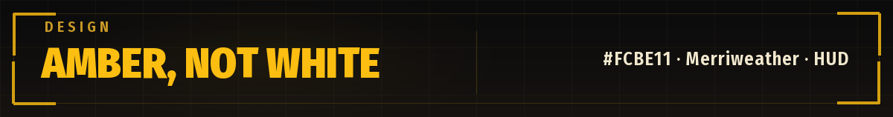

# Panel design

The local panel borrows its visual language from
[mpv-config](https://github.com/mfascioli/mpv-config): an amber-on-charcoal HUD
with square corners, hairlines and condensed type. This file records that
language and the layout rules; the product documentation lives in the
[README](../README.md).

## Tokens

| Token | Value | Used for |
| --- | --- | --- |
| Accent | `#FCBE11` | titles, active keys, focus, the version chip |
| Hairline | `#1F1F1F` | card borders and table rules |
| Shadow | `#33000000` | 20 % black behind floating surfaces (ARGB) |
| Background | charcoal gradient with a faint grid | page and strips |
| Radius | at most `2px` | every control, never pills or bubbles |

Headings are **Merriweather Bold 700**, served from `web/fonts/` under the SIL
OFL, so the panel needs no network and no installed fonts. Body copy and
labels use the system sans stack. The type scale is small and consistent:
section titles, card titles, key/value rows, captions.

The same palette and frame are used by `assets/banner.py` for the README
strips, which is why the screenshots and the documentation look like one
product.

## Reading order

The flow is numbered on screen: **01 Lights → 02 Session → 03 Look →
04 Direct control → 05 Activity**. The numbers are part of the design, not
decoration: they explain the path from choosing bulbs to watching the effect.

## Layout

- **01 Lights** spans the full width. Rooms sit directly above the bulb list;
  the separate Zone map column and its legend are gone, and each row keeps the
  small zone preview where its zone is chosen. Each row also has identify, an
  inclusion switch and a two-step **Forget** action; forgetting removes the
  row and its room membership, never the bulb itself.
- **02–04** use two independent stacks: **02 Session** and **03 Look** on the
  left, **04 Direct control** on the right. Each column grows at its own pace,
  so a short Session never stretches to match a tall Direct control. A
  collapsed card keeps only its header.
- **Session** is one compact row — mode, start, stop — and only adds its start
  time while a sync is running.
- **Direct control** owns power: one switch for the selected bulb, room or all
  bulbs. **Saved colors** reapply a hex and its brightness, and **Saved
  scenes** live in a small `
` submenu inside the card, not as a card of
  their own.
- **05 Activity** is a full-width card below the stacks and holds the
  performance chart, with video and capture resolution, read fps and process
  count visible above it.
- **Look** is three equal hairline columns — **Preset / Sample / Send** — with
  flat key/value rows, never nested boxes. **Preset** leads with the Reaction
  group: the dropdown (with a **Video** / **Audio** optgroup each and one hint
  line for the selected mode), Reaction strength, a **Reaction profile** select
  with its own hint, the Equalize target luma slider and five band color
  swatches. The **Capture & fade preset** select follows the reaction group,
  with a hint naming what it bundles, then Brightness and the **Vibrance**
  slider that multiplies the style's saturation. The profile select, target
  and band row appear only for the reactions that use them, while the capture
  preset, Brightness and Vibrance are always visible; the band swatches are
  one hairline row of five equal `input[type="color"]` cells labelled Sub, Low,
  Low-mid, Mid and High. Reactions never add a fourth column or a second card.
- Below `1000px` both stacks flatten to a single column in 01 → 05 order.
  `prefers-reduced-motion` disables transitions.

The content is capped at 1080px, so the desktop layout is what the screenshot
and the tests describe; narrower windows reflow. There is no build step: the
panel is plain HTML, CSS and JavaScript under `web/`.

## Performance chart

**Activity** holds one frame with three unit lanes — CPU %, RAM MB, UDP KB/s —
and a line for mpv and for the panel in each lane they share. CPU is a share of
the whole processor and the legend says so in a tooltip. Series colors are
chalk-style and deliberately muted:

| Series | Color |
| --- | --- |
| mpv CPU | `#e08c82` |
| panel CPU | `#9fcf9f` |
| mpv RAM | `#fcbe11` |
| panel RAM | `#8fb6db` |
| WiZ UDP | `#b9a0d8` |

The lanes are never merged onto one axis: percent, megabytes and kilobytes per
second cannot share a scale honestly. The time axis is relative and re-renders
when the card opens or the window resizes. Above the chart, one line shows the
video size, the capture size, the read rate and the process count, so the
resolution is readable without hovering a tooltip.

## Contract

[`tests/test_design.py`](../tests/test_design.py) pins the tokens, the square
corners, the bundled font and licence, the numbered order, the two independent
stacks, the integrated scenes submenu, the three Look columns and the chart
IDs. A restyle that drifts back to a generic dashboard fails CI; change the
test only when the design decision changes.

`docs/gui.png` is a real screenshot of the panel in `--demo` mode. Retake it
when the layout changes instead of mocking one up.
